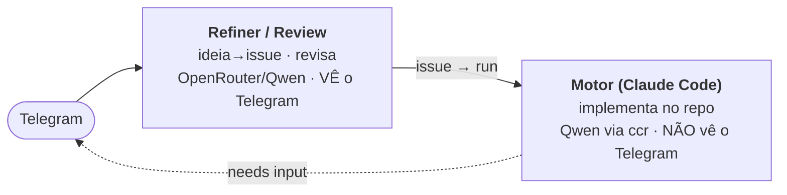
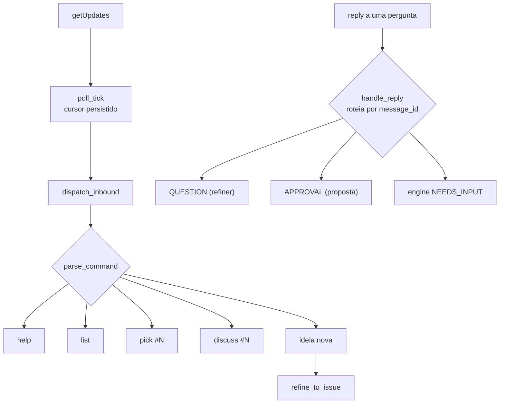
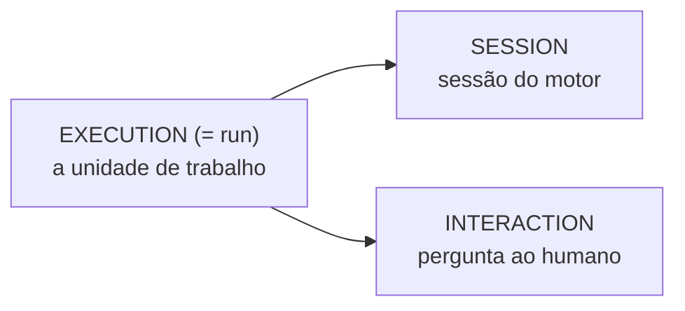
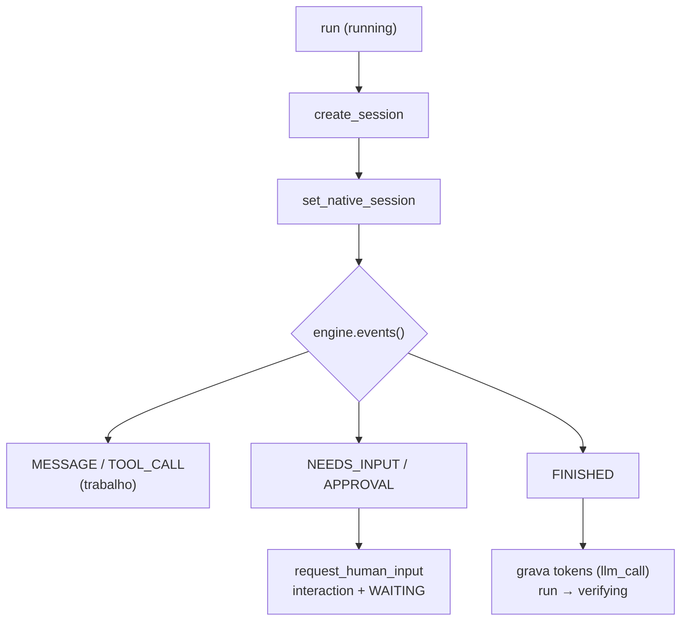

# Arquitetura do Potter — sessão (Claude Code) + interface do Telegram ⚡

Esquemático de como as peças conversam. Dois princípios: **determinismo primeiro** (código no
roteamento; LLM só no julgamento/geração) e **Telegram = conversa, GitHub = registro** (D30).

## Os dois "cérebros"

O Telegram **não** fala com o Claude Code direto. A ponte é: `Telegram → issue → run → motor`.
Durante um run, se o motor precisa de algo, vira **pergunta no Telegram** (D24) e a resposta volta.

## Interface do Telegram (inbound/outbound)

*Legenda:* `pick`/`discuss` trabalham uma issue; `ideia nova` vira issue via refino; o `reply` a uma
pergunta é roteado pelo `message_id` da mensagem enviada (D24).

Saída: tudo que o bot manda passa pelo **outbox** (`telegram_notify` / `telegram_question`). O
`telegram_question` **guarda o message_id** da mensagem enviada — é o que permite rotear o *reply*.

## Gerência de sessão — os 3 IDs (D23)

- **execution (= run)**: a unidade de trabalho (uma issue/ideia). Máquina de estados:
  `queued → running → waiting(AWAITING_HUMAN) → verifying → done|failed|abandoned`.
  Tabela `run` (carrega `origin_chat_id` p/ o feedback voltar ao Telegram certo).
- **session**: uma sessão do **motor** (Claude Code) dentro de um run. Guarda o
  `native_session_id` (o id de sessão do próprio Claude Code, p/ `resume`). Tabela `session`.
- **interaction**: uma pergunta/decisão/aprovação ao humano (ou a semente/turnos da conversa de
  refino). Roteada por `channel_message_id` (o reply). Tabela `interaction`.

Fluxo de uma sessão do motor (`engine_loop.drive_turn`):

> ⚠️ **Gap conhecido:** hoje o caminho real de código (`pega #N` → `run_pr_cycle`) chama
> `engine.start()`/`events()` **direto** e **não grava `session`** — só o `drive_turn` (stub) grava.
> Então o `native_session_id` do Claude Code ainda **não é persistido** nos runs de código reais.

## Onde cada coisa é gravada (Postgres)

| Tabela | O que guarda |
|---|---|
| `run` | execuções (estado, tentativa, lease, origin_chat_id) |
| `run_event` | trilha de transições do run |
| `outbox` | efeitos a efetuar (create_issue/update_issue/telegram_*) — gravar→commit→efetuar |
| `session` | sessões do motor (native_session_id do Claude Code) |
| `interaction` | perguntas/decisões/aprovações + turnos da conversa (roteio por message_id) |
| `session_event` | feed legível do motor por execução (message/tool_call) — SSE do cockpit (Fatia 2) |
| `app_config` | config do fleet (fonte única); `.env` semeia no boot; tela de setup grava aqui |
| `execution_pr` | PR + diff da execução (cache p/ o cockpit, Fatia 4); verdade canônica = GitHub |
| `llm_call` | medição de token/custo por chamada (refiner + juiz + motor) |
| `channel_cursor` | offset do Telegram (retoma no restart, não reprocessa) |

## Console / viewer (http://host:8088)

| Endpoint | Mostra | Plotado no viewer? |
|---|---|---|
| `/executions` | lista de runs | ✅ |
| `/interactions` | interações pendentes (inbox) | ✅ |
| `/interactions/{id}/answer` | **responder HITL** pelo cockpit (Fatia 3; 1ª válida vence) | ✅ (inbox) |
| `/costs` | tokens/custo (llm_call) | ✅ |
| `/executions/{id}` | **detalhe**: run + **sessões** + **conversa completa** | ✅ (botão "ver") |
| `/executions/{id}/terminal` | terminal do container (ttyd+tmux, D25) | ✅ (botão "Terminal") |
| `/executions/{id}/events` | **feed ao vivo** do motor (SSE: message/tool_call, Fatia 2) | ✅ (painel "Feed") |
| `/executions/{id}/diff` | **diff do PR** da execução (Fatia 4; cache em `execution_pr`) | ✅ (painel "Diff") |
| `/executions/{id}/message` · `/interrupt` | **co-piloto** (Fatia 5): steer/interromper a sessão viva (`SessionHub`) | ✅ (painel "Co-piloto") |
| `/costs` | tokens/custo (llm_call) + **agregado por execução** (Fatia 4) | ✅ |
| `/issues` | **issues abertas** do repo (Fatia 6; com labels + filtro) | ✅ (aba "Issues") |
| `/issues/{n}` · `/issues/{n}/refine` | corpo+DoR da issue · **conversa de refino** (OpenRouter) | ✅ (painel de refino) |
| cancel / retry | ações no run | ✅ |

## Issue inteligente (scope) + second brain

- **Scope (D31):** ideia nova pelo Telegram → run `scope` → o **motor LÊ o repo** (AGENTS.md, código
  via code-intel/ripgrep, issues) e monta uma issue **fundamentada** → proposta→OK (D30).
  Impl: `app/scope.py` (`process_scope_tick`, laço próprio que não bloqueia o poll).
- **Second brain (D32, trilha G):** fatos/decisões em `memory_fact` + **índice FTS** (recall
  determinístico, **sem LLM**); o scope injeta os fatos relevantes no prompt. `lembra: X` popula.
  Verdade = texto; índice = derivado/rebuildável.
