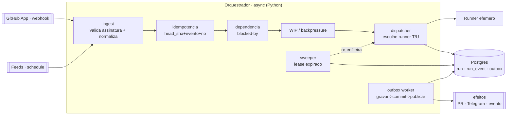
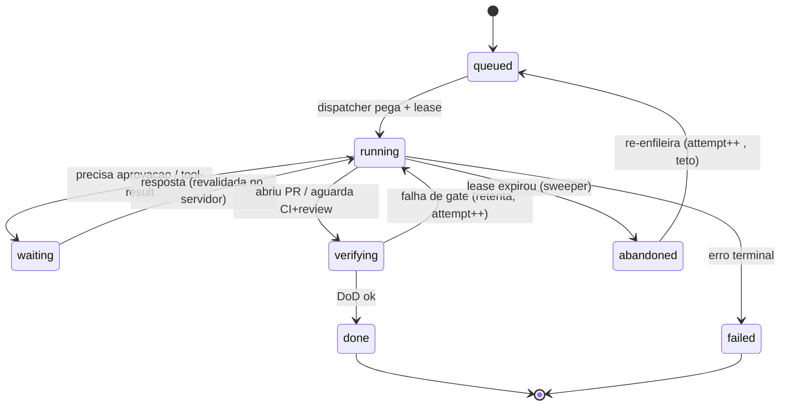
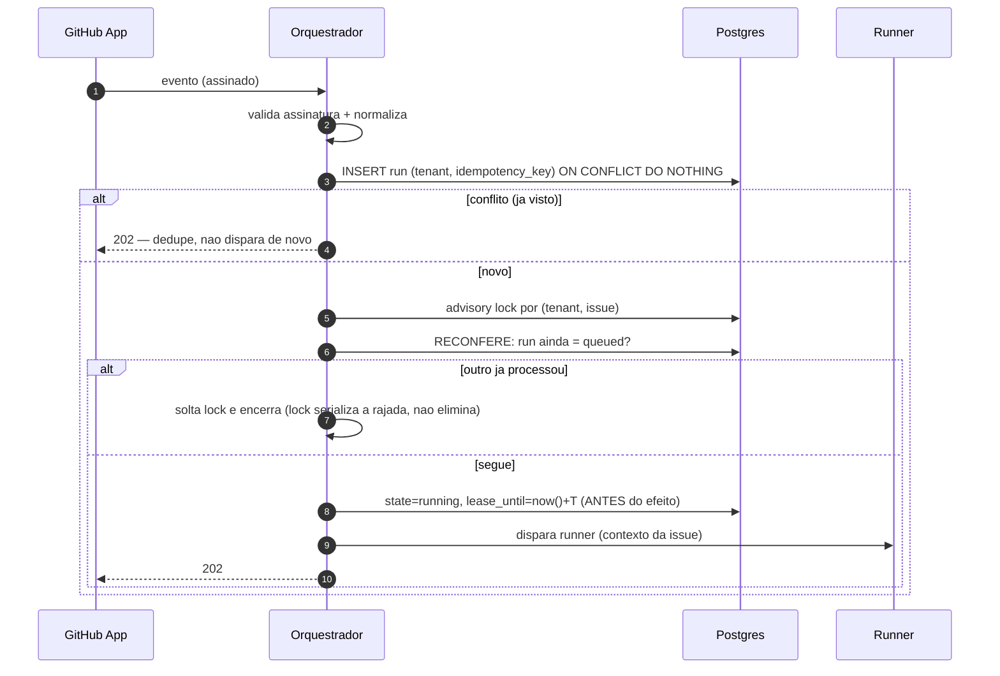
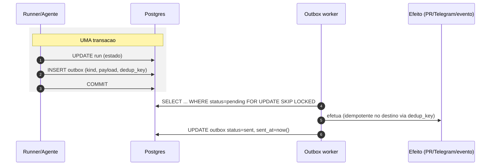
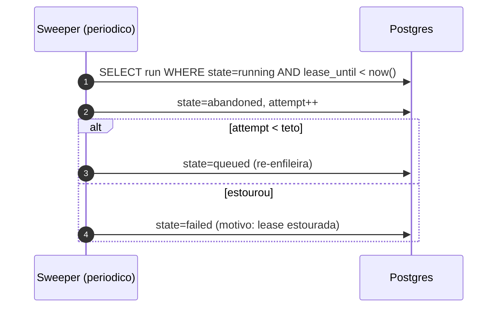

# Design · Orquestrador mínimo (MVP)

> Fase: IMPLEMENTAÇÃO. Spec do **próximo componente a construir** (spec-driven, D13) — a ser revisada
> antes do código. Aprofunda `research/DESIGN-nucleo.md` (D8/D9) para o nível de implementação.
> **Schema real = `migrations/`**; erros via **`Result`** (D1); `tenant` em tudo (D17).

## 1. Objetivo e escopo

O orquestrador é a **camada determinística** que recebe eventos do GitHub (e feeds), decide **o que
roda, quando e onde**, e garante **durabilidade** (nada se perde num crash). **Não é um agente** — não
chama LLM; só coordena. Agentes rodam nos **runners efêmeros** que ele dispara.

**MVP faz:** ingest de evento (webhook assinado) → idempotência → lock/serialização por issue →
máquina de estados do run no banco → dispatch para runner → **outbox** para efeitos → **sweeper** de
run abandonado. Multi-repo de **uma empresa** (1 instância, D17).

**MVP NÃO faz (depois):** durable-execution engine (fica no "leve", D5), grafo de dependência
completo (começa com `blocked-by` simples), runner isolado gVisor (chega com PR externo), múltiplos
tenants no mesmo processo (1 instância por empresa).

## 2. Componentes



**O que este desenho decide:**
- **Pipeline linear com portões** (ingest→idem→dep→wip→disp): cada portão é uma decisão
  determinística; nenhum chama LLM.
- **Idempotência ANTES de dependência** (⚠️): entrega é *at-least-once* — deduplicar antes de agendar
  evita disparar a mesma task duas vezes.
- **Sweeper e outbox worker são laços próprios** (não no caminho do evento) — rodam em periodicidade
  (D3), independentes.

## 3. Máquina de estados do run



**Invariante central:** o estado é gravado **ANTES** de qualquer chamada externa — um crash no meio é
sempre recuperável (resume de estado verificado, H). `waiting` nunca vive no chat (M).

## 4. Fluxo de dispatch (idempotência + lock + reconferir)



⚠️ **RECONFERIR dentro do lock é obrigatório** (DESIGN-nucleo): quem esperava no lock, sem a segunda
checagem, refaz o trabalho que o outro já fez.

## 5. Outbox (efeitos exactly-once)



⚠️ **Ordem obrigatória: gravar → commit → efetuar.** Efeito antes do commit faria a entrega virar a
fonte da verdade. `PUBLISH` ao-vivo (Redis, se houver) fica **fora** da transação.

## 6. Sweeper (run abandonado)



## 7. Contratos (assinaturas — tudo `Result`, sem exceção p/ fluxo)

```python
async def ingest(ev: GithubEvent) -> Result[RunId, IngestError]        # valida+persiste (idempotente)
async def claim_next(tenant: str) -> Result[Run | None, DbError]        # lock + reconfere
async def dispatch(run: Run) -> Result[None, DispatchError]             # state=running (antes do efeito) + spawn
async def enqueue_effect(tx, kind, payload, dedup_key) -> Result[None, DbError]  # na MESMA tx do estado
async def publish_pending(limit: int) -> Result[int, DbError]           # outbox worker; retorna nº efetuado
async def sweep(now: datetime) -> Result[int, DbError]                  # retorna nº reclamado
```
`IngestError` inclui `InvalidSignature`, `Duplicate` (não é erro fatal — vira 202). Erros de infra
(DB, rede) → `Err`, com backoff; nunca derrubam o processo em silêncio.

## 8. Tenancy e multi-repo (D17)

- **1 instância por empresa**; **GitHub App** instalado na org → webhooks de **N repos**; token
  por-repo de escopo mínimo.
- `tenant` em `run`/`outbox`/`llm_call`; `repo` no `run`. Lock e WIP **por (tenant, issue)** e limite
  **por repo e por empresa**.

## 9. Configuração (env / vault)
`DATABASE_URL` · credenciais do GitHub App (via ansible-vault, D4) · lista de repos do tenant · teto
de WIP · `LEASE_SECONDS` · intervalos do sweeper/outbox (D3) · `ANSIBLE_VAULT_PASSWORD` (CI).

## 10. Invariantes (resumo)
1. Estado **antes** do efeito externo. 2. **Reconferir dentro do lock.** 3. **gravar→commit→efetuar**
(outbox). 4. Resume só de estado **verificado**. 5. `tenant` em tudo. 6. Orquestrador **não chama LLM**.

## 11. O que falta para fechar (checklist de build)
| Peça | Estado | Nota |
|---|---|---|
| `ingest` + validação de assinatura do webhook | ⬜ | GitHub App (HMAC) |
| tabela/repo de `run` + INSERT idempotente | ⬜ | usa `migrations/0001` |
| `claim_next` (advisory lock + reconferir) | ⬜ | `pg_try_advisory_lock` por (tenant,issue) |
| `dispatch` → runner (stub no MVP) | ⬜ | runner real vem no loop núcleo |
| `outbox` worker (`FOR UPDATE SKIP LOCKED`) | ⬜ | efeitos: PR/Telegram |
| `sweeper` periódico | ⬜ | lease expirado |
| transporte: webhook server (FastAPI) vs Actions | ⬜ | decidir no arranque (B: Actions+runner JIT) |
| testes tier-1 de cada contrato (fakes de DB) | ⬜ | determinístico, sem LLM |

---
Amarra: B (gatilhos/idempotência) · M (outbox/estado/Telegram) · H (resume verificado) · K (runner) ·
L (`llm_call` quando o runner chamar modelo) · D17 (tenant). Núcleo lógico: `research/DESIGN-nucleo.md`.
