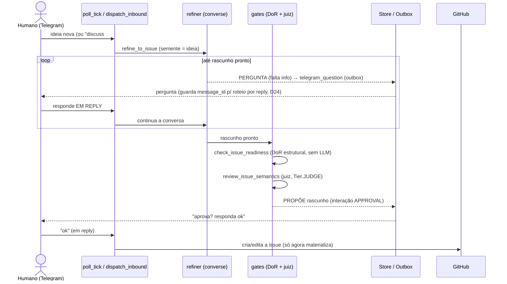
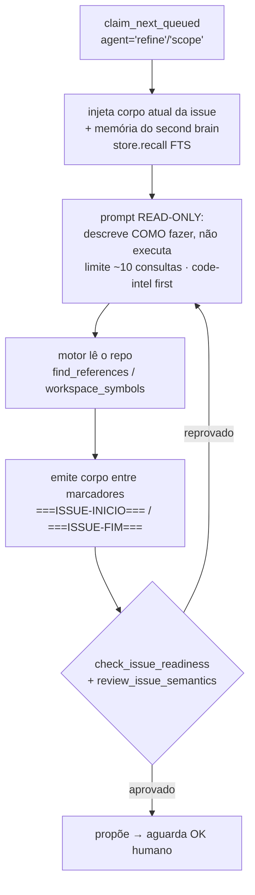

# 1. Refinamento — ideia → issue acionável (DoR)

**Objetivo:** transformar um pedido humano numa **issue acionável** (Definition of Ready), fundamentada
no repo real — nunca "chutada" às cegas. O fleet **não cria a issue sozinho**: só o **OK humano**
materializa (D30).

Decisões de base: [`issue-forming-engine-scoped` (D31)], [`telegram-conversa-issue-registro` (D30)].
Código: `src/roboto/app/refine.py`, `src/roboto/app/scope.py`, `src/roboto/agents/refiner.py`,
`src/roboto/agents/review.py` (gates), `src/roboto/app/loops.py:process_refine_tick`.

## Dois modos de refinar

| Modo | Gatilho | Quem lê o repo | Código |
|---|---|---|---|
| **Conversacional** | mensagem no Telegram (ideia nova ou `discuss #N`) | o entrevistador (`converse`, Qwen) pergunta/propõe; não navega o código a fundo | `app/refine.py` |
| **Engine-scoped** | run `agent='refine'`/`'scope'` | o **motor (Claude Code)** lê o repo em modo leitura (code-intel/ripgrep) e propõe fundamentado | `app/loops.py:process_refine_tick`, `app/scope.py:run_scope` |

O modo engine-scoped (D31) fecha a reclamação do "refino cego": o agente realmente lê `env.ts`, os
usos de um símbolo, etc. — com **limite duro (~10 consultas de leitura)** para não varrer o repo.

## Fluxo conversacional (Telegram, D30)



Pontos determinísticos:
- A conversa é **idempotente por canal+message_id** (update duplicado do Telegram não reprocessa).
- A semente (`_SEED = "IDEIA_INICIAL"`) guarda a 1ª ideia no início do transcript.
- `discuss_issue` injeta título+corpo da issue existente e **ajusta, nunca cria outra**.
- O corpo da issue só é editado **com OK humano** (Telegram = conversa, GitHub = registro, D30).

## Fluxo engine-scoped (o motor lê o repo)



- Os eventos do motor viram **feed ao vivo** no cockpit (`session_event`) e o uso de token é medido
  (`record_llm_call`).
- O "📝 Aplicar na issue" extrai **só o que está entre os marcadores** `===ISSUE-INICIO===` /
  `===ISSUE-FIM===` (o motor pode narrar/pensar fora deles).

## Os gates da issue (a "escada")

`src/roboto/agents/review.py`:

1. **DoR estrutural — `check_issue_readiness`** (tier 1, **sem LLM**): exige as 4 seções
   `_REQUIRED_SECTIONS = (Contexto, Escopo, Critérios de aceite, DoD)` **e** ao menos um item
   `- [ ]`. `ready` só quando nada falta.
2. **Juiz semântico — `review_issue_semantics`** (Tier.JUDGE): avalia se é *acionável* (critérios
   verificáveis, escopo claro, DoD significativo, sem ambiguidade). Veredito com parsing
   determinístico (`_parse_verdict`).

O resultado é sempre **proposta**: a issue só nasce/é editada com o **OK humano** no reply.

## Formato de saída (DoR) exigido

```
TITLE: <título curto em Conventional Commits>
BODY:
## Contexto
## Escopo
## Critérios de aceite
- [ ] <verificável>
## DoD
- [ ] testes · lint/typecheck · review · CI
## Fora de escopo
```

## Próximo passo

Issue pronta (DoR) → entra na fila para o fluxo de [Implementação](02-implementacao.md).
