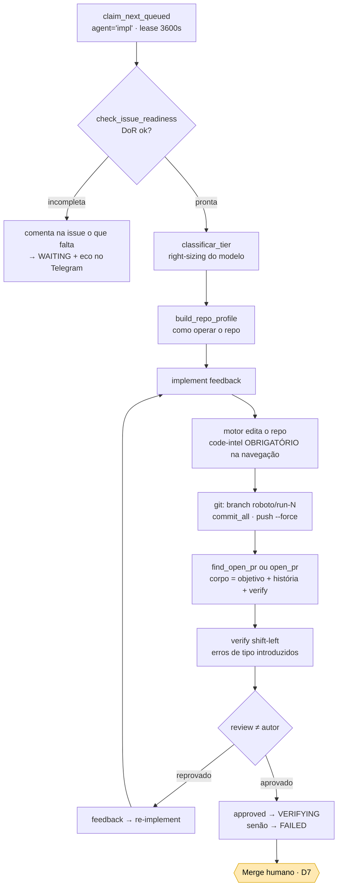
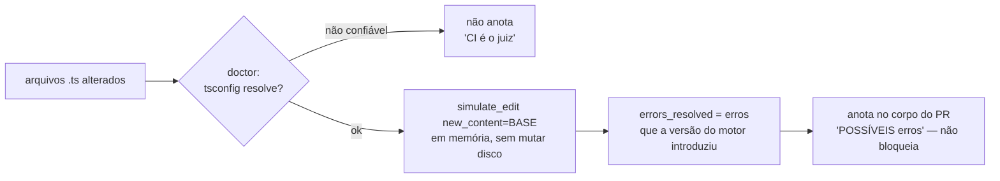

# 2. Implementação — issue → branch → PR

**Objetivo:** pegar uma issue pronta (DoR) e produzir um **PR revisável** contra a base (gitflow:
`develop` no alvo), com o motor editando o repo como um dev. O **merge é gate humano** (D7).

Código: `src/roboto/app/pr_cycle.py` (`process_pr_run_tick`, `run_pr_cycle`),
`src/roboto/engines/claude_code.py` (motor), `src/roboto/app/git_ops.py`, `src/roboto/app/verify.py`,
`src/roboto/app/tiering.py`, `src/roboto/app/repo_profile.py`.

## Visão do ciclo

## Passo a passo (o que `run_pr_cycle` faz)

1. **Contexto da issue** — puxa título+corpo do GitHub (`get_issue`), injeta o **corpo no prompt**
   (requisitos) e monta `Closes #N`. Sem isso o motor só vê o número e se perde.
2. **Right-sizing (`classificar_tier`, determinístico)** — tarefa grande/arquitetural roda no **tier
   forte** (`ROBOTO_STRONG_MODEL`, default `openrouter,anthropic/claude-sonnet-4.6`); pequena fica no
   motor barato (Qwen, `model=""` = default do ccr). O id no formato `provider,model` é a **sintaxe
   de override** que faz o ccr rotear para esse modelo (senão ignora e usa a config).
3. **Perfil do repo (`build_repo_profile`)** — como operar (package manager, monorepo, test/lint,
   deps instaladas), pro motor rodar os checks como um dev, sem gambiarra.
4. **`base_prompt`** — regras duras: **escopo mínimo** (só os Critérios de aceite; não cria doc/issue
   extra, não edita o épico, não commita lockfile sem a issue pedir), **AGENTS.md + doc-in-sync**,
   **rodar os checks** (lint/typecheck/testes/doc-sync) e corrigir até passar, e a **regra obrigatória
   de navegação por code-intel** (nunca `Read` de arquivo inteiro só para "procurar").
5. **`implement(feedback)`** — `engine.start` → consome os eventos (vira feed do cockpit
   `session_event` + mede token) → **git**: `prepare_branch("roboto/run-{id}")` → `commit_all` →
   `push` (force) → **PR**: `find_open_pr` (idempotência) ou `open_pr` → `get_pr_diff` → cacheia o PR
   no cockpit (`set_execution_pr`).
6. **Corpo do PR (`build_pr_body`)** — `Closes #N` + `## Objetivo` + `## O que foi feito` (história =
   `git log` dos commits do motor) + **seção do verify** (só se confiável).
7. **Review** — via `correction_cycle` (ver [Code review](03-code-review.md)).

## Gate de prontidão (DoR) antes de implementar

`process_pr_run_tick` roda `check_issue_readiness` **antes** de qualquer edição. Issue-esqueleto
→ comenta o que falta na issue, enfileira eco no Telegram, e põe o run em **WAITING** (não chuta, D28).

## Verify determinístico shift-left

`src/roboto/app/verify.py` — o **harness** (não o modelo) pergunta ao code-intel/tsgo quais erros de
tipo a mudança introduziu, **antes de abrir o PR**.

- **Truque:** `simulate_edit(file, new_content=<versão BASE>)` roda em memória; `errors_resolved` = os
  erros que a versão ATUAL tem e a base não = os **introduzidos**.
- **Anota-e-segue:** linguagem é "possível" (pode haver falso positivo); **não bloqueia** (D7).
- **Auto-desliga** quando o `doctor` diz que o tsconfig não resolve (ex.: monorepo com
  project-references) — evita falso positivo tipo `Cannot find name 'process'`.
- O resultado é **cacheado** e **injetado no review** (ver etapa 3).

## Estado final e recuperação

- `result.approved` → `VERIFYING`; senão → `FAILED`. Status final volta pro Telegram (D30).
- **Recuperável:** o run é keyed no banco; em restart o lease expira, o sweeper re-enfileira e
  reprocessa (branch força-push, PR reaproveitado via `find_open_pr`). **Merge nunca é automático.**

## Lacuna conhecida

O fleet **não se atribui como assignee** da issue ao pegar a tarefa (hoje o assignee é só filtro de
opt-in) → [roboto#150](https://github.com/CenturyBoys/roboto/issues/150).
