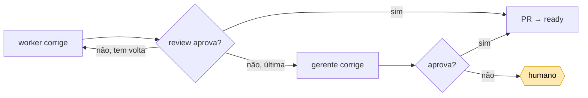
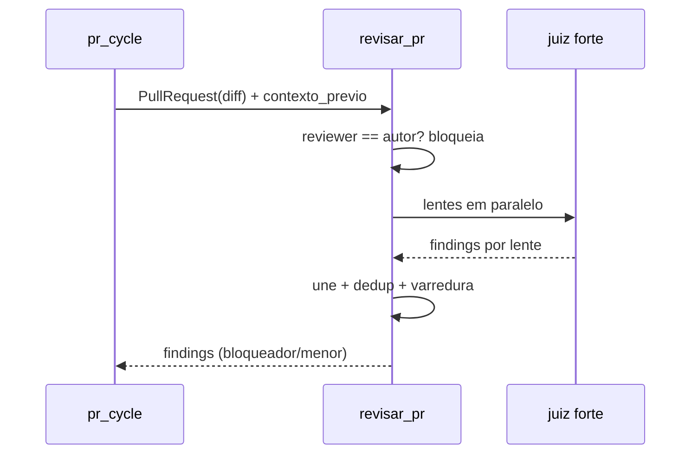

# 3. Code review — PR → veredito → correção

**Objetivo:** julgar o diff do PR com um **revisor ≠ autor** (trilha D), realimentar correções pela
**escada worker→gerente→humano** e parar num veredito confiável. **Aprovação NÃO mergeia** — o merge
é gate humano (D7).

Código: `src/roboto/agents/review.py` (review estruturado + lentes), `src/roboto/app/correction.py`
(`correction_cycle`), `src/roboto/app/pr_cycle.py` (amarração: `implement`/`review`, escada, gates,
`process_correct_tick`), `src/roboto/app/issue_state.py` (projeção de estado → label).

## A escada de correção (worker → gerente → humano)

O loop re-implementa com o feedback do review até aprovar. As primeiras voltas correm no **worker**
(barato); a **última** sobe pro **gerente** (modelo forte) **antes** do humano. Humano é o último
recurso de verdade.

*Legenda:* **worker** = motor barato (ex.: qwen) · **gerente** = modelo forte (Sonnet,
`ROBOTO_STRONG_MODEL`) que **RETOMA a sessão do worker** (resume-forte) — troca só o modelo, não
recomeça · **ready** = PR sai do draft (P0b) · **humano** = último recurso (D7).

O ponto-chave é o **resume-forte**: antes, escalar pro forte começava uma **sessão nova** (re-lia o
repo e re-gerava tudo = caro). Agora o gerente **continua a sessão do worker**, com todo o contexto
(o que foi construído e por quê), e só fecha os pontos do review. O cache de prompt (por-modelo) a
gente abre mão; o **contexto** — que vale muito mais — é preservado.

## Os gates que impedem FALSO "aprovado"

Um review que não roda, ou um CI verde, **não** valem como aprovação. Estes gates garantem que nada
ruim vira um "✅ aprovado" silencioso:

| Gate | Regra | Por quê |
|---|---|---|
| **reviewer ≠ autor** | `reviewer == pr.author` → reprova **sem LLM** | quem escreve não se aprova |
| **fail-closed** | review que **erra** (saldo/timeout) → **NÃO aprova** | erro ≠ "sem problemas"; senão saldo zerado faz TODO PR virar falso-aprovado |
| **CI verde ≠ review ok** | CI verde **não** força aprovação | passar teste não é lógica correta |
| **não aprova sobre CI vermelha** | checks vermelhos → injeta bloqueador | não aprovar código que nem compila |
| **PR escalado não é re-aprovado por CI** | `poll-correct-ci` **não** força "aprovado" se há `needs-human` | PR escalado nunca aprovou — re-revisa de verdade |
| **nasce draft** | PR só vira *ready* quando o review **aprova** (P0b) | run escalado deixa o PR draft + `needs-human` |

## Review rigoroso (multi-lente)

`ROBOTO_REVIEW_STRATEGY=multi` roda **lentes em paralelo** (idempotência/concorrência,
dados/persistência, erro/retry, contrato×teste) e **une** os achados numa passada — em vez de achar
um problema por rodada (whack-a-mole). Mais uma **varredura determinística** de sites irmãos: achado
um padrão num lugar, marca os outros. O revisor roda num **modelo mais forte que o escritor** (guard
de roteamento: se o tier do juiz colide com o do worker, promove).

*Legenda:* **contexto_previo** = reviews anteriores do PR (o juiz VERIFICA cada ponto no diff atual,
não recomeça do zero) · **bloqueador** = reprova; **menor** = não bloqueia.

## Estado do run vira label (e FAILED é retentável)

`issue_state.py` projeta o estado do run mais recente numa label `status:*` no board. A regra que
importa: **`FAILED` → `status:to-do`** (retentável), **não** `status:blocked`.

> Bloqueio (`status:blocked`) significa **dependência não-resolvida** — o gate recusa codar. Um run
> que **falhou** é diferente: é **re-tentável**. Projetar `status:blocked` num run falho criava
> **deadlock** (falhou → blocked → o gate recusa o retry → preso pra sempre).

## Resiliência do motor durante o review/correção

- **Watchdog não mata na espera humana:** se o motor para pedindo uma **aprovação de permissão**, o
  watchdog de inatividade **re-espera** enquanto houver interação pendente (antes, o timeout matava o
  run no meio da espera e a resposta tardia não retomava nada).
- **Gatilho sem webhook:** local não tem webhook; o `process_pr_run_tick` (impl) e o
  `process_correct_tick` (PR já aberto) rodam por polling. O `correct` é um run **separado**
  (`agent=correct`) que lê o código do disco — por isso não tem a sessão do impl pra resumir.

## Depois da aprovação

Aprovado → o PR é **promovido a ready** (`mark_pr_ready`) e fica **OPEN** aguardando o **merge
humano** (D7). O fleet **nunca mergeia sozinho**. Se o review não aprovou, o PR fica **draft +
`needs-human`** — o humano vê o 🚩 e as pendências; não dá pra mergear num clique.

## Lacunas conhecidas

- **Promoção só no fluxo impl:** hoje só a aprovação do `process_pr_run_tick` tira o PR do draft. Um
  fix direto ou a aprovação do ciclo `correct` **não** promovem — vale ligar o `mark_pr_ready` nesses
  caminhos.
- **Chamada ao modelo sem timeout:** uma chamada LLM pendurada (provedor lento/sem crédito) pode
  travar o run; falta timeout + retry na borda do gateway.

> Mantenha este documento em dia **no mesmo PR** que muda o fluxo (doc-in-sync, AGENTS.md §5).
