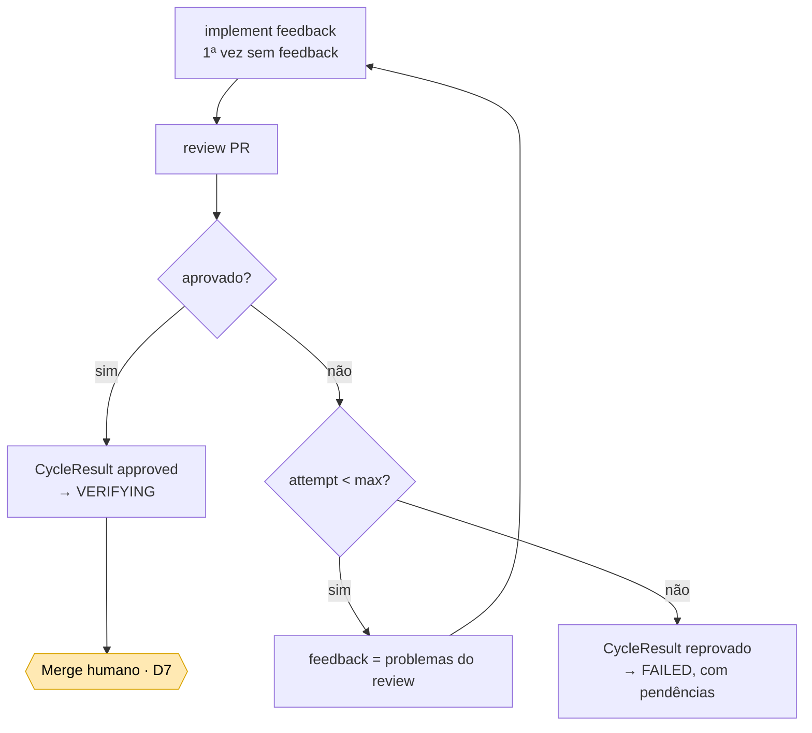
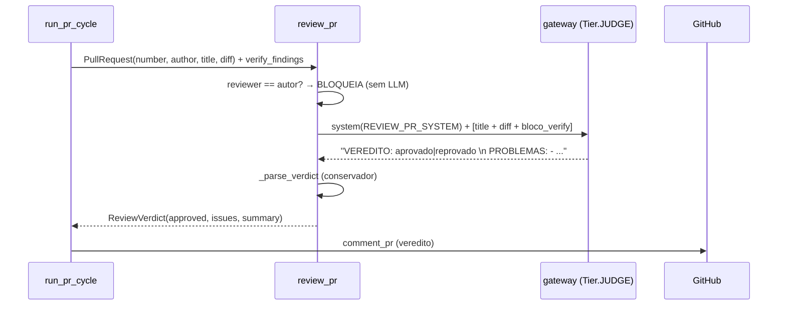

# 3. Code review — PR → veredito → correção

**Objetivo:** julgar o diff do PR com um **revisor ≠ autor** (trilha D), realimentar correções e
parar num veredito. **Aprovação NÃO mergeia** — o merge é gate humano (D7).

Código: `src/roboto/agents/review.py` (`review_pr`, `_parse_verdict`), `src/roboto/app/correction.py`
(`correction_cycle`), `src/roboto/github/webhook.py` (gatilhos), `src/roboto/app/pr_cycle.py`
(amarração + injeção do verify).

## Loop de correção dirigido por review

`correction_cycle` (puro e determinístico): `implement(feedback) → review → se reprovado,
re-implementa com `verdict.issues` → re-review`, até **aprovar** ou **estourar `max_attempts`**. Cada
veredito vira **comentário no PR** (`comment_pr`): `✅ Review aprovado.` ou `🔁 Review pediu correções`.

## O que entra no review (hoje)

`review_pr(pr, gateway, reviewer, verify_findings)`:

- **Reviewer ≠ autor (trilha D):** se `reviewer == pr.author`, reprova sem chamar LLM.
- **Conteúdo = `title + diff + verify_findings`.** Os achados do verify entram como **FATOS/possíveis**
  ("avalie cada um; se real, não aprove sem tratar; se falso positivo, diga no parecer") — pro revisor
  **não aprovar por cima** de erro de tipo. O cache vem do verify da implementação (não recomputa).
- **Veredito conservador (`_parse_verdict`):** aprovado **só** com "aprovado" explícito **e sem**
  "reprovado" — na dúvida, reprova (output do modelo = proposta; política decide, princípio H).

## Gatilhos de review (webhook)

`src/roboto/github/webhook.py` → `_PR_ACTIONS`:

| Ação do GitHub | Dispara? | Observação |
|---|:--:|---|
| `opened` | ✅ review | PR novo |
| `synchronize` | ✅ review | **novo push** → re-review (idempotency inclui o `head_sha`) |
| `reopened` | ✅ review | |
| `pull_request_review` / `dismissed` | ❌ | review removido por alguém **não** re-dispara |
| `check_suite` / `status` | ❌ | mudança de status/checks **não** re-dispara |

O filtro `_is_for_fleet` só aciona em PR com o `bot_login` entre os assignees ou a label-gatilho.

## A escada completa de review (contexto)

O review de PR é o 3º degrau; os dois primeiros são na issue (ver [Refinamento](01-refinamento.md)):

1. `check_issue_readiness` — DoR estrutural da issue (tier 1, sem LLM).
2. `review_issue_semantics` — juiz semântico da issue (Tier.JUDGE).
3. `review_pr` — review do diff do PR, **reviewer ≠ autor**.

## Lacunas conhecidas

- **Review é stateless** — vê só `title + diff + verify_findings`, **cego** aos comentários e reviews
  anteriores do PR. Num re-review (após push humano), recomeça do zero sem memória do que já foi dito.
- **Dismissal não re-dispara** — o cenário "alguém removeu nosso review e subiu commit" passa batido.

Ambas endereçadas por [roboto#151](https://github.com/CenturyBoys/roboto/issues/151) (carregar
comentários/reviews do PR e injetar no prompt + tratar `pull_request_review:dismissed`).

## Depois da aprovação

Aprovado → run vai a **VERIFYING** e o PR fica **OPEN** aguardando o **merge humano** (D7). O fleet
nunca mergeia sozinho.
