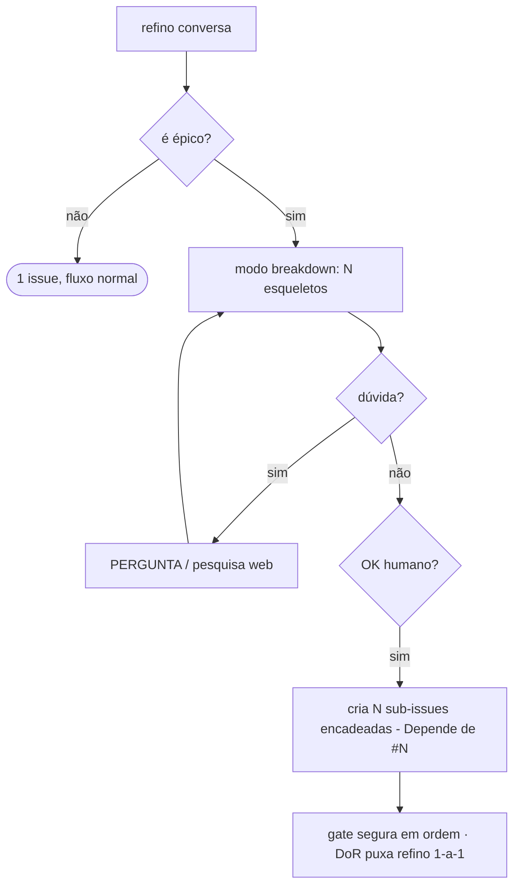

# Breakdown de épico (refino destrincha épico em sub-issues)

> **Em construção** — feature #203. O refino/definição de issue é o **coração do fleet**; esta
> trilha o ensina a reconhecer um **épico** e destrinchá-lo **ponto a ponto** em sub-issues
> **esqueleto**, conversando com o humano nas dúvidas e encadeando por dependência.

## Visão

Hoje o refino é **1→1** (um pedido → uma issue). Um épico é largo demais para uma issue só. A ideia:

1. **Detectar** que a issue é um épico (heurística determinística — não decisão cega de LLM).
2. Entrar em **modo breakdown**: propor **N sub-issues leves** (título + pontos a cobrir), a decisão
   do destrinchar **conversada** com o humano.
3. **Pesquisar na web** quando o texto não basta (validar lib/versão, abordagem) e citar a fonte.
4. Perguntar (`PERGUNTA:`) o que não dá pra inferir de texto/pesquisa.
5. Com **OK humano**, materializar as sub-issues no GitHub **encadeadas** (`Depende de #N`), linkadas
   ao épico. Cada uma é **refinada a fundo 1-a-1** depois, quando for a vez.

O encadeamento pluga direto no **gate de dependência** ([`app/deps.py`](../trilha-j-escala.md)):
a sub-issue `Depende de #N` fica em `WAITING` até a anterior fechar. E o **DoR gate** garante que um
esqueleto não é implementado antes de ser refinado — a própria falta de DoR puxa a conversa 1-a-1.

## O que já existe (incrementos 1–2)

**Incremento 1 — base determinística** em [`agents/breakdown.py`](https://github.com/CenturyBoys/roboto/blob/main/src/roboto/agents/breakdown.py):

- **`is_epic(title, body)`** — heurística: "épico"/"epic" como palavra no título é sinal forte;
  senão soma sinais do corpo (palavra épico, ≥8 checkboxes, ≥3 cenários/critérios, menção a
  breakdown) e decide por ≥2 sinais. "epicentro" **não** dispara (casamento por palavra).
- **`parse_breakdown(text)`** — lê o formato que o motor emite (`ITEM:` + pontos `- `), encadeia
  sequencialmente (cada item depende do anterior), com `DEPENDE: nenhuma` para quebrar a cadeia.
- **`skeleton_body(item, prev_number)`** — monta o corpo do esqueleto; a frase `Depende de #N` é a
  mesma que o gate `blocked_by` reconhece, garantindo o encadeamento ponta a ponta.

**Incremento 2 — modo breakdown conversacional** em `agents/refiner.py`:

- **`breakdown_converse(transcript, gateway)`** — passo multi-turno (espelha o `converse()` do
  refino normal): devolve uma **pergunta** (`PERGUNTA:`) quando falta info, ou o **breakdown**
  (lista de esqueletos já encadeados) quando dá pra propor.
- **`BREAKDOWN_SYSTEM`** — o contrato do prompt: ordena por dependência técnica, limita a 3–6 itens,
  e **instrui a pesquisar na web** (validar lib/versão/abordagem) **citando a fonte** — efetivo
  quando o motor por trás tem acesso à internet (Claude Code), como combinado.

**Incremento 3 — materializar no GitHub** em `app/breakdown_apply.py`:

- **`materialize_breakdown(github, repo, epic_number, breakdown)`** — cria as sub-issues **em ordem**,
  cada uma com `Depende de #<número real da anterior>` (números que só existem após criar → criação
  sequencial) + `Parte do épico #N`. Comenta no épico o **índice** das filhas (guarda-chuva).
- **Encadeamento real:** a dependência aponta pro número GitHub de fato, então o gate `blocked_by`
  já segura cada filha em WAITING até a anterior fechar. `DEPENDE: nenhuma` no meio não encadeia.
- **Fail-fast:** para na 1ª falha de criação (não deixa cadeia pela metade silenciosa); as já criadas
  permanecem e aparecem no comentário do épico.

**Incremento 4 — cockpit (endpoints + painel)**:

- **`POST /issues/{n}/breakdown`** (propor) — checa `is_epic`, roda `breakdown_converse` semeado com
  título+corpo do épico, devolve `{question}` **ou** `{items}` — **sem criar nada** (409 se não parece
  épico).
- **`POST /issues/{n}/breakdown/apply`** (materializar) — recebe os itens **confirmados/editados pelo
  humano** e chama `materialize_breakdown`. Só cria o que o painel enviou (OK humano no código).
- **Painel `BreakdownPanel`** no refino: botão *Destrinchar épico* → lista editável (título, pontos,
  "depende da anterior") → *Criar N sub-issue(s)*; mostra os links das filhas criadas. O *Destrinchar*
  nunca cria; a criação é um segundo clique explícito.

## Próximos incrementos

5. Dogfood: destrinchar um épico real (ex.: #66 do arenavalendo) pela UI.
