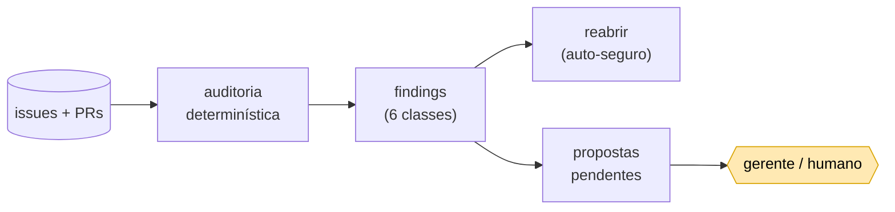

# 5. Saúde do grafo — auditoria, cura e transitividade

**Objetivo:** manter o **grafo de issues/dependências** confiável sem humano na mão. O driver de
épico só confia no grafo se ele estiver são; este fluxo **detecta** inconsistências (determinístico),
**cura** o que é seguro sozinho e **surfa** o resto pro gerente/humano.

Código: `src/roboto/app/graph_doctor.py` (detecção + heal, puro), `src/roboto/app/graph_loader.py`
(carrega do GitHub + orquestra), `src/roboto/app/reconcile.py` (runs órfãos), `src/roboto/app/deps.py`
e `issue_graph.py` (parsers de aresta), `web/ui/src/lib/graph.ts` (transitividade no mapa).

## O graph doctor

Determinismo acha o problema; o heal **só reabre** sozinho (protetor, nunca perde trabalho); fechar,
repontar, refino e ciclo ficam **pendentes** pro gerente/humano. Endpoint `POST /graph-audit`;
no cockpit, o botão **🩺 doctor** no mapa de issues.

*Legenda — as 6 classes:* **closed-dep-open** (fechada mas depende de aberta) · **closed-but-reverted**
(fechada por PR revertido/não-mergeado) · **redundant-skeleton** (esqueleto de dep já feita) ·
**prose-unwired** (dep em prosa, não `#N`) · **aging-orphan** (esqueleto nunca refinado) · **cycle**.
**auto-seguro** = só reabrir (reabrir nunca perde trabalho); o resto é proposta.

## Dependência é aresta `#N`, não prosa

O gate/driver só enxerga dependência **legível por máquina** (`Depende de #N`). Dois cuidados que
eram buracos reais:

- **Parser tolerante a markdown:** `**Depende de:** #281` perdia o `#281` em silêncio (o `**`
  quebrava o regex). Agora tolera ruído de markdown entre a frase e o `#N`.
- **Épico-pai nas duas convenções:** `Parte do épico #N` **e** `Epico: #N` — antes só a primeira
  casava, então a filha ficava **órfã** da árvore (aparecia como raiz/épico de topo).
- **Self-heal checa-antes-de-criar:** antes de abrir o esqueleto de uma dep nomeada (ex.: "T1"), olha
  se ela **já foi satisfeita** (PR mergeado / issue fechada) → se sim, **não cria** redundante; e
  **wire-a** a aresta `Depende de #N` no corpo do pai (não deixa a dep órfã).

## Reconcile de runs órfãos

Sem webhook, nada avisa que o PR mergeou ou que o motor morreu. Um `reconcile_active_runs` (tick de
15s) fecha runs presos em estado ativo (RUNNING/VERIFYING/WAITING) **de forma determinística, sem
chutar por tempo**:

| Sinal no GitHub | Ação |
|---|---|
| PR **mergeado** | run → `DONE` |
| PR **fechado sem merge** | run → `ABANDONED` |
| **issue do run fechada** (sem PR linkado) | run → `DONE` |
| PR/issue ainda **aberto** | mantém (legitimamente ativo) |

> Fecha o caso do run "zumbi": o motor morre em RUNNING, a issue fecha por outro caminho, mas o run
> ficava `running` pra sempre segurando lock/WIP. Nada de staleness por tempo — `updated_at` não
> reflete atividade de um run longo legítimo.

## Transitividade no mapa (bloqueador-raiz / destrava N)

A transitividade é **derivada das arestas**, não materializada nos corpos (duplicar `Depende de #N`
desincroniza). No mapa, cada issue mostra:

- **🔒 raiz: #N** — o bloqueador **aberto** no fundo da cadeia que de fato a trava (ex.: toda a cadeia
  de um épico aponta pra mesma fundação aberta).
- **🔓 destrava N** — quantas issues ela libera em cascata quando fechar (a alavanca dela).

A cadeia só anda por nós **abertos** — um bloqueador fechado/ausente está resolvido e some do `⛔`.

> Mantenha este documento em dia **no mesmo PR** que muda o fluxo (doc-in-sync, AGENTS.md §5).
