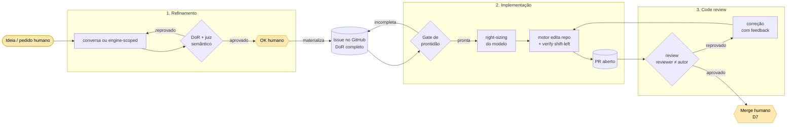
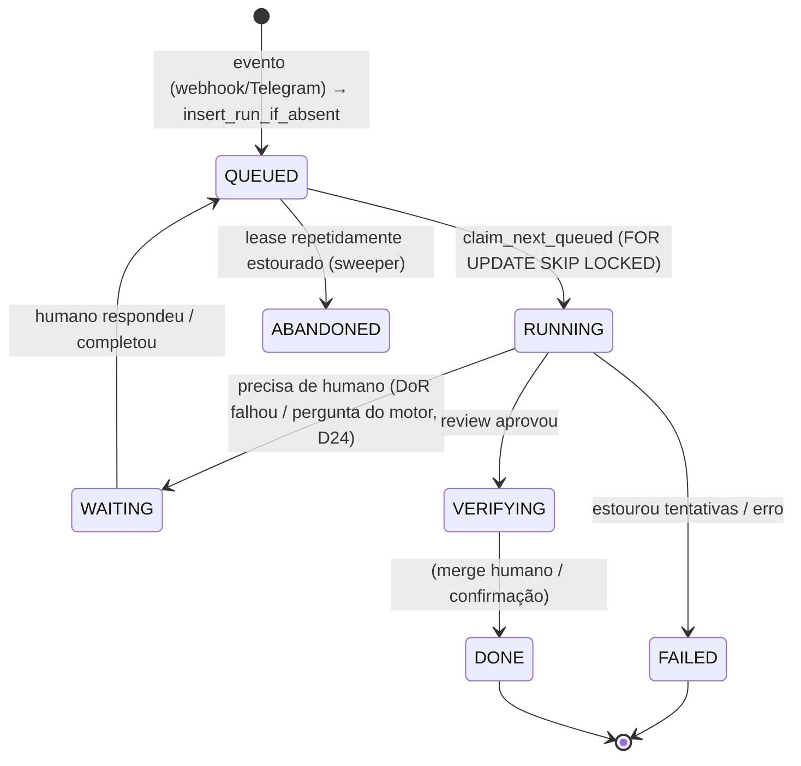

# Fluxos do roboto — refinamento, implementação e code review

Visão geral dos **três grandes fluxos** do sistema, como funcionam hoje (código real) e onde estão
os gates. Um documento por etapa:

1. [Refinamento](01-refinamento.md) — ideia → issue acionável (DoR).
2. [Implementação](02-implementacao.md) — issue → branch → PR.
3. [Code review](03-code-review.md) — PR → veredito → correção (merge = humano).

Dois princípios atravessam tudo (AGENTS.md): **determinismo primeiro** (código no roteamento; LLM só
no julgamento/geração) e **output do modelo = proposta; política determinística decide**.

## Ciclo ponta a ponta

O **merge nunca é automático** (D7): aprovado pelo review, o PR fica OPEN aguardando o humano.

## Máquina de estados do run (orquestrador)

Todo trabalho é um `Run` persistido (`src/roboto/orchestrator/model.py` → `RunState`). O estado é a
verdade recuperável: em restart, o lease expira e o sweeper re-enfileira.

Agentes (coluna `agent` do run, roteados por `claim_next_queued(agent=...)`):
`triage` · `refiner` · `refine` · `scope` · `impl` · `review`.

## Processos que sustentam os três fluxos (fáceis de esquecer)

Além das três etapas, estes processos existem hoje e aparecem nos documentos:

| Processo | Onde | Papel |
|---|---|---|
| **Triagem** (`issues:opened` → `triage`) | `github/webhook.py` | classifica issue nova recém-aberta |
| **Gate de prontidão (DoR)** | `agents/review.py:check_issue_readiness` | barra issue-esqueleto antes do dev (tier 1, sem LLM) |
| **Verify shift-left** | `app/verify.py` | erros de tipo introduzidos, ANTES do PR (code-intel/tsgo) |
| **Right-sizing de modelo** | `app/tiering.py:classificar_tier` | tarefa grande → Sonnet; pequena → Qwen (determinístico) |
| **Correção dirigida por review** | `app/correction.py:correction_cycle` | re-implementa com o feedback até aprovar/teto |
| **Second brain (memória)** | `store.recall` (FTS, sem LLM) | injeta fatos/decisões no refino |
| **Interação humana no meio do run (D24)** | `app/engine_loop.py:drive_turn` | motor pergunta → Telegram → resposta retoma |
| **Observabilidade / cockpit** | `session_event`, `set_execution_pr` | feed ao vivo + PR/diff no console (trilha O) |
| **Metering de token** | `app/metering.py:MeteredGateway`, `record_llm_call` | custo por execução (trilha L) |
| **Outbox / efeitos** | `enqueue_effect("telegram_notify")` | status volta pro Telegram de quem pediu (D30) |
| **Recuperação** | `claim_next_queued` + lease + sweeper | run keyed no banco; reprocessa sem perder |

## O que ainda NÃO existe (lacunas conhecidas)

- **Gate humano de merge não é um passo automatizado** — é intencional (D7): o fleet para no PR
  aprovado. Não há automação de merge, e não deve haver sem gate.
- **Auto-atribuição da issue ao pegar a tarefa** — hoje o assignee é só filtro de opt-in, o bot não
  se marca como responsável. → issue [roboto#150](https://github.com/CenturyBoys/roboto/issues/150).
- **Re-review com contexto completo do PR** — o review é stateless (só o diff), cego aos comentários
  e reviews anteriores; dismissal de review não re-dispara. → issue
  [roboto#151](https://github.com/CenturyBoys/roboto/issues/151).

> Mantenha estes documentos em dia **no mesmo PR** que muda o fluxo (doc-in-sync, AGENTS.md §5).
