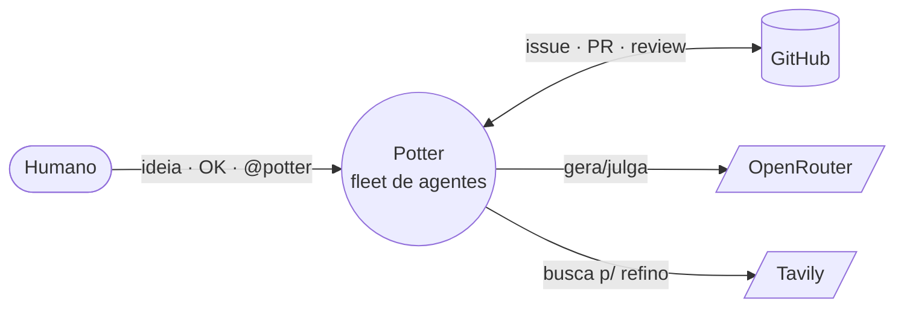
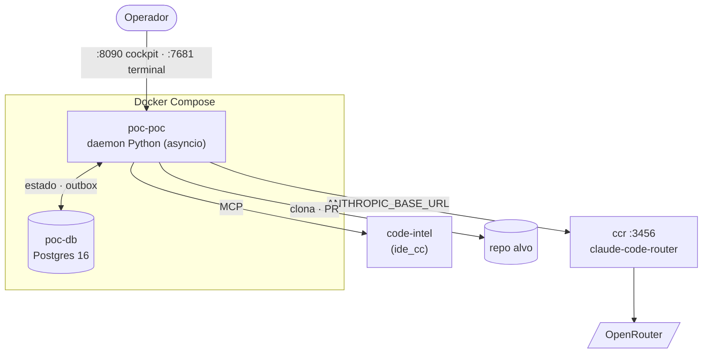
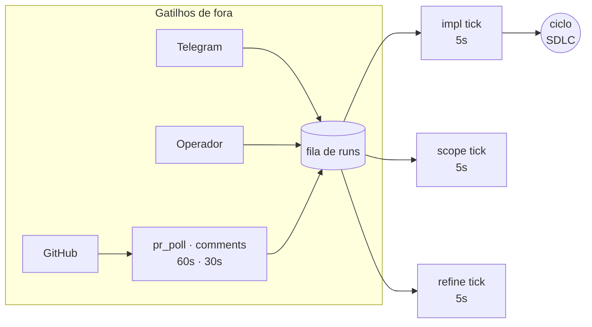
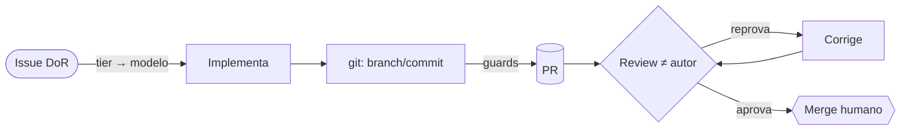
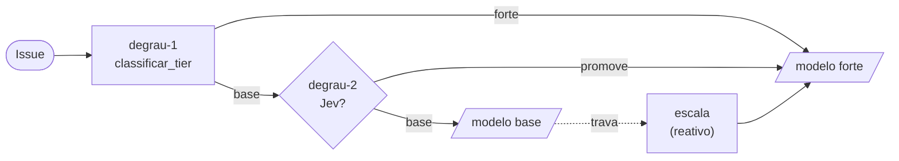
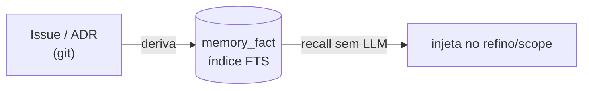

# Mapa do sistema — Potter ⚡

> Visão consolidada: **arquitetura + regras + gatilhos**, do contexto até os laços, com um resumo
> das propostas até aqui. Diagramas no estilo **C4 (níveis de zoom)** mas com traço **fluido** — a
> ideia é dar o "onde estou" sem a rigidez de caixa. Convenção: [diagramas](convencao-diagramas.md).

O Potter é um **fleet de agentes** que cobre o ciclo de vida de software tendo o **GitHub** como
substrato (Issue = verdade, PR/CI = feedback). Dois eixos o governam: **determinismo primeiro**
(código decide o roteamento; LLM só gera/julga) e **economia de token** (sessões curtas, modelo
do tamanho da tarefa).

---

## Nível 1 — Contexto (quem conversa com o fleet)

*Legenda:* o humano nunca fala com o motor direto — ele conversa (Telegram/cockpit) e **aprova**; o
registro mora no GitHub. `OpenRouter` serve todos os modelos; `Tavily` só alimenta o refino.

**Regra-mãe:** _output do modelo = proposta; política determinística decide._ Merge é **gate
humano** (D7); quem gera **não** valida (reviewer ≠ autor).

---

## Nível 2 — Contêineres (o que roda no PoC)

*Legenda:* um único **daemon** carrega ASGI (webhook+cockpit), os laços e o motor. O **ccr** traduz
a API Anthropic→OpenRouter (por isso o motor "é Claude Code" mas roda Qwen/Gemini). `code-intel` dá
navegação/edição **semântica** verificada. Portas: **8090** cockpit, **7681** terminal (ttyd+tmux).

| Contêiner / serviço | Papel |
|---|---|
| `poc-poc` (daemon) | ASGI + laços periódicos + motor de coding; clona o alvo em `/work/<owner>/<repo>` |
| `poc-db` (Postgres) | verdade operacional: runs, outbox, sessões, interações, custos, memória |
| `ccr` (:3456, interno) | adapter Anthropic→OpenRouter; honra override `provider,model` |
| `code-intel` (MCP) | símbolos/refs/edição verificada (harness-driven, não auto-uso do modelo) |
| `ttyd`+`tmux` (:7681) | terminal web por-run (co-piloto, D25) |

---

## Nível 3 — Os laços (quem aciona trabalho)

Tudo é **polling** de laços periódicos (`run_periodic`): sem webhook no PoC, o daemon drena a fila e
o GitHub a cada N segundos. Um tick que falha **não derruba** o laço.

*Legenda:* `impl/scope/refine/correct/revert` rodam a cada **5s**; `pr_poll` 60s, `comments` 30s,
`labels` 20s, `close_merged` 15s; `outbox` 1s. A fila (tabela `run`) é o ponto único de convergência.

| Laço | Cadência | O que faz | Onde |
|---|---|---|---|
| **impl** (`process_pr_run_tick`) | 5s | pega run `QUEUED` → ciclo issue→PR→review→correção | `app/pr_cycle.py` |
| **scope** (`process_scope_tick`) | 5s | ideia nova → motor lê o repo → propõe issue | `app/scope.py` |
| **refine** (`process_refine_tick`) | 5s | lapida a issue (DoR/DoD); busca web se crítico | `app/loops.py` |
| **correct** (`process_correct_tick`) | 5s | corrige um PR já aberto conforme o review | `app/pr_cycle.py` |
| **revert** (`process_revert_tick`) | 5s | recuperação git-first: reverte PR, reabre issue | `app/revert.py` |
| **pr_poll** | 60s | PR estabilizou (debounce) → enfileira `correct` | `app/pr_poll.py` |
| **comments** | 30s | `@potter <cmd>` nos comentários (anti-loop) | `app/comment_poll.py` |
| **labels** | 20s | projeta o estado do run → label `estado:*` | `app/issue_state.py` |
| **close_merged** | 15s | reconcilia VERIFYING contra o PR real (merge→DONE) | `app/reconcile.py` |
| **outbox** | 1s | efetua efeitos (criar issue / Telegram / pergunta) | `orchestrator/core.py` |

---

## O ciclo SDLC (ponta a ponta)

*Legenda:* entre `git` e o PR rodam os **guards determinísticos** (secret-scan, hook/prettier/i18n,
code-intel diag e a **porta de CI local** — `lint`/`typecheck`/`test`, a mesma do CI, antes do push).
O review é **estruturado** (lenses); reprova = bloqueador; converge em ≤3 rodadas (bound da
literatura). Só o humano mergeia.

**Regras do ciclo:**

- **Issue-first:** nada coda sem issue completa (gate de DoR); task de _definição_ não vira código.
- **Guards antes do push:** segredo nunca é versionado; hook que barra vira correção determinística
  (i18n/prettier) ou 1 turno do motor — não "empurra à força".
- **Dependência:** `blocked by #N` aberta → espera, não coda sobre o inexistente.
- **Recuperação:** falhou terminal → `revert` reabre a issue; o fleet não deixa lixo mergeável.

---

## Escada de validação + tier → modelo

A decisão de **qual modelo** implementa é uma escada que só sobe de custo quando precisa:

*Legenda:* **degrau-1** é determinístico (nº de arquivos citados + vocabulário arquitetural). Só
se ele disser _base_ o **degrau-2 (Jev)** opina — pode **promover** issue ampla que o keyword não
pegou (nunca rebaixa). Em runtime, se o base **trava**, o degrau de escalonamento sobe pro forte
(**reativo**). Opcional **proativo**: `ROBOTO_FORTE_FINALIZE` faz o base rascunhar e o forte fechar
a parte chata (diag/hook/correção). Detalhe: [trilha I](trilha-i-roteamento.md).

**Por que escada:** modelo fraco **flaila** em tarefa difícil (queima token); o tier manda a tarefa
difícil pro modelo capaz, que **não** flaila. Guard-rails: cap de tool-calls + budget de token
cortam o burn mid-stream.

---

## Second brain (memória)

*Legenda:* a **verdade** é a issue/ADR versionada; o `memory_fact` é um **índice derivado**
(rebuildável) para recall **determinístico** (sem LLM). O harness injeta os fatos relevantes no
prompt — o modelo não "descobre" nem invoca tool de busca (mesma decisão do code-intel e da web:
**harness-driven**). Detalhe: [trilha G](trilha-g-memoria.md).

---

## Regras invioláveis (o que nunca muda)

| Regra | Por quê |
|---|---|
| **Determinismo primeiro** | código no roteamento; LLM só gera/julga. O CI é o juiz do "pronto". |
| **Merge = gate humano (D7)** | o fleet propõe; a pessoa decide o que entra no `main`. |
| **Reviewer ≠ autor** | quem gera não valida — review por outro agente/lente. |
| **Issue é o registro; Telegram é conversa (D30)** | editar corpo de issue só com OK humano. |
| **Agnóstico de plataforma** | o núcleo não conhece GitHub; GitHub é adapter (trocável). |
| **Harness-driven** | nenhum modelo auto-usa code-intel/web/memória — o harness roda e injeta. |
| **Ferramentificação** | operação repetida vira artefato durável (script/MCP/guard). |

---

## Propostas até agora (resumo)

O que já está **de pé** (validado no PoC vivo contra um repo real):

- **Ciclo completo**: refino → impl → commit → PR → review (≠autor) → correção → merge humano.
  Entregou PRs reais no alvo.
- **Guards determinísticos**: secret-scan, hook/prettier/**i18n** (stub determinístico), code-intel
  **diag**, **porta de CI local** (lint/typecheck/test antes do push — PR não nasce vermelho),
  baseline (dívida pré-existente não vira culpa do fleet).
- **Tiering em 2 degraus**: determinístico + **Jev** (degrau-2); escalonamento **reativo** quando o
  base trava + **finalize proativo** atrás de flag. Cap de tools + budget de token contra flailing.
- **Escolha de modelo (empírica)**: **base** = Qwen3-Coder-30B; **forte** = Gemini 3.1 Flash Lite
  (entrega, chama tool, barato). Todos via **ccr→OpenRouter**.
- **Second brain**: `memory_fact` (FTS) como índice derivado; verdade = issue/ADR.
- **Cockpit web + terminal**: feed ao vivo (SSE), diff, custos, co-piloto (steer/interrupt), terminal
  por-run (ttyd+tmux).
- **Persona por papel**: âncora de papel no refino/impl (A/B validado, default ON).

Em aberto / próximos:

- **Medir** o A/B do `FORTE_FINALIZE` e da promoção do Jev (quando o keyword erra).
- **Cockpit torre-de-controle** (trilha O): PWA instalável, não adotar ferramenta pronta.
- **Self-host dos LLMs** (ambiente 128GB): validar candidatos via OpenRouter antes do hardware.

> Mapas vizinhos: [arquitetura (sessão/Telegram)](arquitetura.md) · [gatilhos](triggers.md) ·
> [fluxos](fluxos/README.md) · trilhas A–M.
