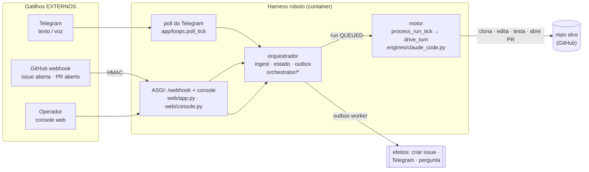

# Gatilhos externos do harness (quem aciona o fleet) + mapa de arquivos

Visão do que dispara trabalho no `roboto` **de fora** e onde cada peça vive no código. Tudo converge
pro mesmo núcleo (store/estado/outbox) — sem estado paralelo.

## Diagrama

## Os gatilhos e onde vivem
| Gatilho externo | O que dispara | Arquivo(s) |
|---|---|---|
| **Telegram — texto/voz** | humano manda ideia → **refino → cria issue**; voz → STT | `channels/telegram.py` (poll/STT) → `app/loops.py` `poll_tick` → `app/inbound.py` `dispatch_inbound` → `app/refine.py` |
| **Telegram — reply** | resposta a uma pergunta do agente → roteia pela interação | `app/inbound.py` → `app/human.py` `handle_reply` |
| **GitHub webhook** | **issue aberta → run `triage`**; **PR aberto/sync → run `review`** | `web/app.py` (`POST /webhook`) → `github/webhook.py` (`verify_signature`/`normalize_event`) → `orchestrator/core.py` `ingest` |
| **Console web (operador)** | listar/inspecionar · **cancelar/retentar** · terminal | `web/console.py` |
| **Laço do motor** (interno, consome a fila) | pega run `QUEUED` → dirige o Claude Code | `app/loops.py` `process_run_tick` → `app/engine_loop.py` `drive_turn` → `engines/claude_code.py` |
| **Periódicos** (internos) | outbox worker (efeitos) · sweeper (lease) | `orchestrator/core.py` `publish_outbox`/`sweep`, agendados em `runtime.py` |
| **Boot** | sobe ccr + clona repo + daemon | `poc/entrypoint.sh` → `runtime.py` (`python -m roboto`) |
| *(futuro)* feeds/cron | checagens periódicas (D3) | — ainda não implementado |

## E a revisão de PR? (status honesto)
- O **gatilho** existe: um `pull_request` aberto/sincronizado vira um run com `agent="review"`
  (`github/webhook.py` → `_PR_ACTIONS`). Entra na fila como qualquer run.
- O **agente de revisão em si NÃO está implementado**. Hoje o `process_run_tick` dispara o
  **motor genérico** (`ClaudeCodeEngine`) com um prompt genérico — não há a lógica especializada de
  review nem a regra **reviewer ≠ autor** (desenhada na trilha D, `research/D-review-de-pr.md`).
- Ou seja: **sabemos acionar** a revisão; falta **construir o agente** que a executa (prompt/skill de
  review + política reviewer≠autor + postar comentários no PR). É um próximo incremento.

## Autenticação de cada gatilho
- **GitHub webhook**: HMAC-SHA256 (`GITHUB_WEBHOOK_SECRET`) — só no modo App; no PoC PAT não há webhook.
- **Telegram**: allowlist de user IDs (`channels/telegram.py`).
- **Console**: bearer token (`CONSOLE_TOKEN`), isolado por empresa (run de outro tenant → 404).
