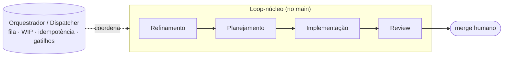

# Trilha 0 — Mapa de papéis → agentes (como funciona)

> Documento **operacional** (como o sistema funciona hoje). O *porquê* / a investigação fica em
> [`research/00-mapa-de-papeis.md`](https://github.com/CenturyBoys/roboto/blob/main/research/00-mapa-de-papeis.md).
> **Princípio-âncora:** agente de LLM **só onde há julgamento ou geração irredutível a código** —
> o resto vira processo/CI (determinismo primeiro). **Status:** o loop-núcleo de agentes está no `main`.

## 1. As lentes de decisão

Para cada responsabilidade de uma org de tech, decidir **(a) agente dedicado**, **(b) processo
determinístico**, ou **(c) híbrido**:

- **Determinismo primeiro:** se vira script/CI/processo, **não** vira agente de LLM.
- **Lente DBA-ORM:** a ferramenta absorve a complexidade → o papel se dissolve (schema virou
  código + migrations).
- **Taxonomia de gatilho:** cada agente é **reativo** (evento), **ambiente** (feed/schedule) ou
  **sob demanda** (humano invoca).

## 2. Papel → decisão → o que existe no fleet hoje

| Papel | Decisão | No fleet hoje |
|---|---|---|
| Produto / refinamento | híbrido (gera issue; prioriza = humano) | ✅ `agents/refiner` + `app/scope` (trilha A/B) |
| Planejamento (estados) | agente + **muito processo** | ✅ `task_class` + `issue_state` (determinístico, A) |
| **Implementação** | **agente dedicado (núcleo)** | ✅ `ClaudeCodeEngine` + `app/pr_cycle` (B) |
| **Code Review** | **agente dedicado** | ✅ `agents/review` reviewer≠autor (D) |
| QA / Teste | híbrido, inclinado a processo | ✅ gate = **CI** + evals (H); agente de test-gen = follow-up |
| Segurança | híbrido | ✅ **secret-scan** determinístico (H); agente-ambiente de feeds = follow-up |
| Documentação | híbrido | ✅ **doc-guard** + skill docs (processo); agente de drift = follow-up |
| Arquitetura | híbrido (gate humano) | ⚠️ tier forte no right-sizing (I); agente dedicado = follow-up |
| SRE / Incidente | híbrido (deploy=processo) | ⬜ follow-up (depende de produção) |
| DBA | **dissolvido** | ✅ schema=código + review; competência de dados vira regra no AGENTS.md (E) |
| Release Manager | **processo** (não-agente) | ✅ merge humano + Conventional Commits (B/J) |

## 3. Lista canônica de agentes (e o orquestrador)

**Entregues (loop-núcleo):** Refinamento, Planejamento, Implementação, Review — o loop
issue→PR→review. **Dissolvidos em processo:** QA (CI é o juiz), release, DBA, grande parte de DevOps.
**Orquestrador/Dispatcher** = camada **determinística** (trilhas B/J/F) que coordena tudo e mantém o
contexto global — não é um dos agentes de domínio.

**Agentes laterais (follow-up):** Arquitetura/Design dedicado, Testes (test-gen), Segurança-ambiente
(triagem de CVE por feeds), Documentação (detecção de drift), SRE/Incidente.

## 4. Fonte da verdade

Esta é a **lista canônica** que alimenta a orquestração (B) e as skills (C). Gates humanos
(priorização, merge, decisão arquitetural) são explícitos na [Trilha H](trilha-h-qualidade.md).
Ordem de construção seguiu o grafo mínimo: Refinamento → Planejamento → Implementação → Review.
