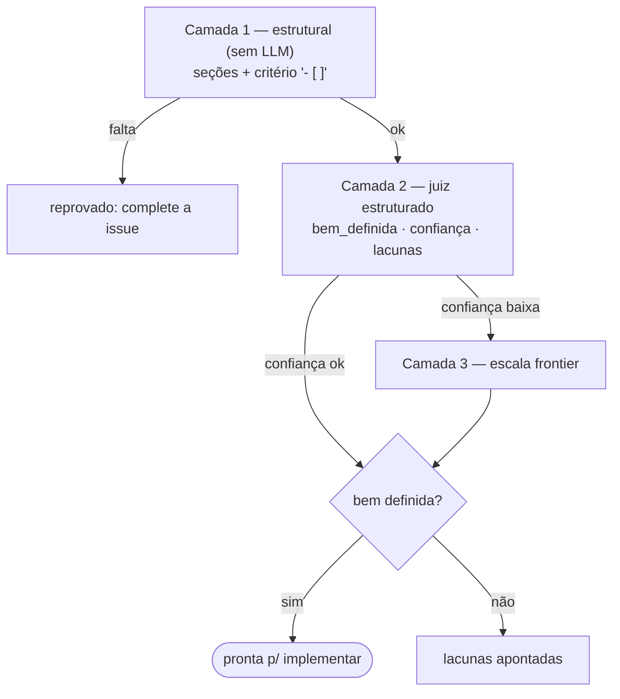
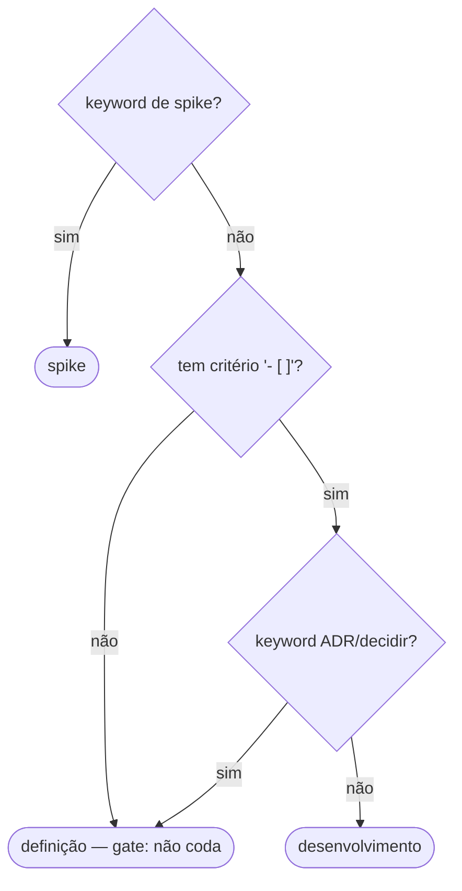

# Trilha A — Contratos de trabalho (como funciona)

> Documento **operacional** (como o sistema funciona hoje). O *porquê* / a investigação fica em
> [`research/A-contratos-de-trabalho.md`](https://github.com/CenturyBoys/roboto/blob/main/research/A-contratos-de-trabalho.md).
> **Princípio-âncora:** o contrato (o que é issue/DoR/DoD/estado/tipo) é **agnóstico de plataforma**;
> o GitHub é um **adapter** (labels, templates). Trocar de plataforma = trocar o adapter.

## 1. O que a trilha entrega

O **contrato de trabalho**: o que é uma issue acionável (DoR), quando está pronta (DoD), qual a
**natureza** da task (e o que NÃO pode ser codado), e como o **estado** da issue é visível. Nada coda
sem issue pronta; o "pronto?" é decidido por regra/CI, não por LLM caro (determinismo primeiro).

## 2. DoR — validador de prontidão em 3 camadas (#160)

Barato-primeiro: só escala o custo quando a dúvida justifica.

| Camada | O que faz | Onde |
|---|---|---|
| **1 — estrutural (sem LLM)** | exige seções (`Contexto/Escopo/Critérios de aceite/DoD`) e **critério verificável** `- [ ]` **sob** "Critérios de aceite" (enxerga subseções `###`) | `agents/review.check_issue_readiness` |
| **2 — semântica (juiz barato)** | saída **ESTRUTURADA** `{bem_definida, confianca, lacunas[]}` (não binária) | `agents/review.validar_issue_semantica` (Tier JUDGE) |
| **3 — escalada** | se a **confiança é baixa**, re-avalia no **tier forte** (frontier) e usa esse veredito | idem (Tier FRONTIER) |

**Quem gera não valida:** o gerador/refino (`refiner.converse`) roda em **Tier.CHEAP**; o validador em
**JUDGE/FRONTIER** — modelos diferentes pelo roteamento do gateway. O juiz é **determinístico**
(`temperature=0`) + rubrica (ver trilha B / `REVIEW_PR_SYSTEM`).



## 3. Tipagem de task + gate anti-codar-definição (#158)

Toda task tem uma **natureza** (classificador determinístico, `app/task_class.classificar_task`):

| Tipo | Produz | "Done" | Vai pra impl? |
|---|---|---|---|
| **definicao** | spec/decisão (ADR/RFC) | spec aprovada | **NÃO** |
| **desenvolvimento** | código + testes | PR verde + review | sim |
| **spike** | investigação/protótipo descartável | achados documentados | não |

Também estima o **size** (XS…XL) por sinais (nº de critérios + arquivos citados) — alimenta
right-sizing e priorização. **Gate:** no dispatch de `impl` (`process_pr_run_tick`) e no botão
Implementar do cockpit, uma task de **definição CONFIANTE** (keyword ADR/RFC/decidir, sem critério) é
**barrada** — fica `WAITING` com aviso. Ambíguo (sem critério + sem keyword) segue pro gate de DoR
(pedir pra completar), sem bloquear. O Jev (LLM barato) entra como **escalada** na dúvida.



## 4. Máquina de estados da issue → labels (#161)

O **estado canônico** é o `RunState` do run mais recente da issue (vive no daemon). Um laço periódico
**projeta** esse estado como label `status:*` no GitHub (adapter; dedup — só bate na API quando muda):
`app/issue_state.py`.

```
refine/scope rodando → status:in-progress   refine done → status:to-do (pronta p/ implementar)
impl/correct rodando → status:in-progress    verifying (PR aberto) → status:in-review
done → status:done                           waiting/failed → status:blocked
```

Vocabulário do board: **backlog → to-do → in-progress → in-review → done** (+ blocked). Trocar de
plataforma = trocar o `set_issue_state_label` do adapter, sem tocar o mapeamento (puro, testado).

## 5. DoR/DoD como artefato versionado (#159)

Templates em `.github/ISSUE_TEMPLATE/` (`feature.md`, `epic.md`): a DoR/DoD nascem **no repo**
(versionadas, revisáveis), não na cabeça de quem abre a issue.

## 6. Fonte da verdade

O **daemon** é a fonte da verdade do estado (agnóstico); o GitHub é a **projeção** para humanos
acompanharem (labels `status:*` + issue aberta/fechada). Decisão D12: **estado via labels, Projects
fora**.
