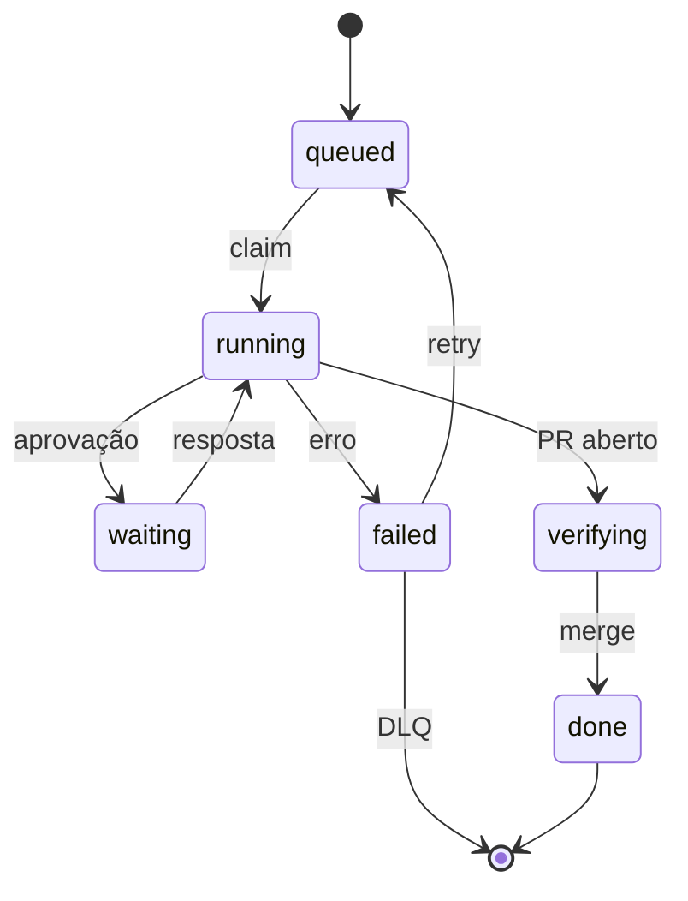
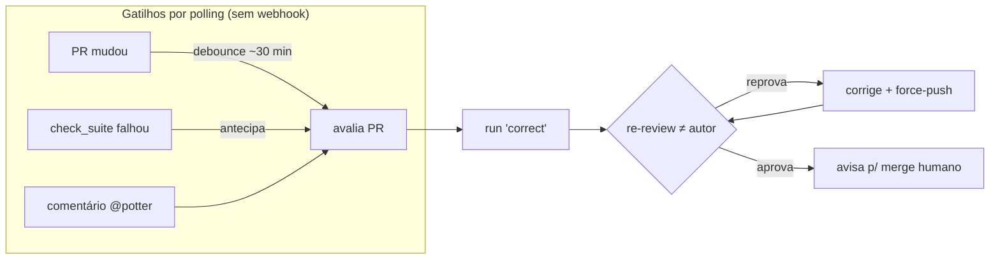

# Trilha B — Orquestração e gatilhos (como funciona)

> Documento **operacional** (como o sistema funciona hoje). O *porquê* / a investigação fica em
> [`research/B-orquestracao-e-gatilhos.md`](https://github.com/CenturyBoys/roboto/blob/main/research/B-orquestracao-e-gatilhos.md).
> **Princípio-âncora:** o núcleo é **agnóstico de plataforma**; GitHub é um **adapter**. A lógica de
> orquestração não conhece GitHub — recebe eventos normalizados e emite efeitos via adapters.

## 1. O que a trilha entrega

Uma **máquina de estados durável** que pega trabalho (evento → `run`), executa com garantias
(idempotência, lock, retry) e produz efeitos **exactly-once na prática** (outbox). Mais os
**gatilhos** que alimentam essa máquina — hoje por **polling** (sem webhook, decisão do dono).

## 2. Núcleo: run, estados e idempotência

- **`run`** = unidade de trabalho `(tenant, repo, issue_id, agent)` com `RunState`
  (`queued → running → waiting/verifying → done/failed/abandoned`). Código: `orchestrator/model.py`,
  `orchestrator/core.py`.
- **Idempotência**: todo evento traz `idempotency_key`; `insert_run_if_absent` deduplica. Entrega
  é *at-least-once* — reprocessar é seguro.
- **Claim serializado**: `claim_next_queued` usa `FOR UPDATE SKIP LOCKED` (sem corrida entre workers).

*Legenda:* **claim** = lock por (tenant, issue) · **erro** inclui o watchdog de inatividade ·
**retry** = backoff exponencial · **DLQ** = dead-letter ao esgotar as tentativas.

## 3. Garantias de resiliência (as 4 peças)

| Peça | O que faz | Onde |
|---|---|---|
| **Retry + backoff + dead-letter** (#163) | run/efeito que falha re-tenta com backoff exponencial (`next_attempt_at`); esgotou → vai pra `dead_letter` com contexto; **replay** manual pelo cockpit | `orchestrator/core.py`, `pg_store.py`, mig. `0009` |
| **Concurrency-lock por (tenant, issue)** (#165) | advisory xact lock + `NOT EXISTS (running/waiting/verifying na mesma issue)` → serializa runs da MESMA entidade | `pg_store.claim_next_queued` |
| **Outbox resiliente** (#162) | um efeito "venenoso" não trava o lote inteiro — os demais publicam | `orchestrator/core.publish_outbox` |
| **Anti-loop** (#164) | ação do bot não re-dispara o bot (distinguido por `(event_type, action)`, não filtro cego) | `github/webhook.py` |

> **Outbox (exactly-once na prática):** grava → commit → publica com `dedup_key`. Efeitos
> (`create_issue`/`update_issue`/`telegram_notify`) passam pelo `RouterPublisher`.

## 4. Robustez do motor (ligada à orquestração)

- **Watchdog de inatividade**: se o motor fica `ENGINE_IDLE_TIMEOUT`s sem evento (subprocesso morto
  sem FINISHED/FAILED), vira **FAILED** em vez de pendurar o run em RUNNING até o lease expirar.
  `app/engine_loop.guarded_events`.
- **Lease + sweeper**: run RUNNING com lease expirado é re-enfileirado (recuperável em restart) —
  **exceto** sob intervenção humana ativa (sweeper pula, #157).
- **Fail-fast do ciclo (#144):** `open_pr` que falha **não** vira PR nº 0 silencioso — propaga e
  FALHA o run; **diff vazio** (motor não editou nada) também falha explícito — não se revisa "o nada".
- **Self-assign (#150):** ao pegar um run de `impl`, o fleet se **atribui como assignee** da issue
  (`github.add_assignee`, best-effort) — rastreabilidade de quem assumiu a tarefa.
- **Retry em erro TRANSITÓRIO (B/H):** erro de provedor temporário (402 sem crédito, 429, 5xx,
  overloaded — `app/transient.is_transient`) **re-enfileira com backoff** em vez de FAILED terminal
  → quando a condição passa (ex.: recarga de crédito), o daemon **retoma sozinho** (teto de tentativas
  → dead-letter se persistir). Erro permanente (git/PR/bug) segue terminal.
- **Sem PR duplicado:** o prompt de implement proíbe o motor de abrir PR/rodar `git push`/`gh` — **o
  fleet** abre o PR (commit→push→`open_pr`); senão saíam 2 PRs (um do motor, um do orquestrador).

## 5. Gatilhos — hoje por POLLING (sem webhook)

Decisão do dono: **nada de webhook** (evita URL pública e acoplamento); o daemon **pergunta "o que
mudou?"** periodicamente. Agnóstico: um *adapter de plataforma* lista o estado; o núcleo decide.

### 5.1 Gatilho por atividade de PR, com debounce (#166)
`app/pr_poll.py` — a cada ~60s, para cada PR aberto:
0. **pula PRs de bot** (`is_bot_author`: `*[bot]`, renovate, dependabot) — o fleet não revisa/corrige
   PR de bot de dependência (gastava token à toa; pego na validação ponta-a-ponta);
1. pega `(número, head_sha, autor)` via `github.list_open_prs` (adapter);
2. `decide_pr` (lógica **pura**, testável) aplica o **debounce**: se o `head_sha` mudou, reinicia o
   relógio; só quando o PR **estabiliza** (≥ `ROBOTO_PR_POLL_DEBOUNCE`, default **30 min**) e o sha
   ainda não foi avaliado → **dispara**;
3. dispara = enfileira um run **`agent='correct'`**, que **re-revisa** o PR e, se reprovar, **corrige**
   (no branch do PR); se aprovar, comenta "nada a ajustar". Humano mergeia (gate).

Estado por PR (`last_seen_sha`, `last_activity_at`, `reviewed_sha`) vive em `pr_review_state`
(mig. `0010`). Idempotente pelo sha — não re-dispara o mesmo estado.

> O passo "corrigir conforme review" é o `process_correct_tick` (`app/pr_cycle.py`): checkout da
> branch do PR → review (revisor≠autor) → corrige → force-push → re-review → comenta.

### 5.2 Review determinístico (gate confiável)
O juiz roda com **`temperature=0`** (`llm/openrouter.py`, tier JUDGE) + **rubrica de severidade**
(`agents/review.REVIEW_PR_SYSTEM`: BLOQUEADOR vs menor; qualquer bloqueador → reprovado). Sem isto o
mesmo diff dava vereditos diferentes e o gate era não-confiável.

### 5.3 Gatilho por comentário `@potter` + check_suite (#166)
- **`@potter <comando>`** num comentário de issue/PR dispara o run: `@potter implementa|refina|revisa`
  → `impl`/`refine`/`correct`. Polling dos comentários (`app/comment_poll.py`), cursor por repo.
- **Anti-loop por MARCADOR** (sem conta de bot): o fleet nunca escreve `@potter` e assina os próprios
  comentários com `<!-- potter:bot -->`; o poller ignora comentário com o marcador.
- **check_suite failed:** se o CI do head do PR falhou, o poller **antecipa** o `correct` (não espera
  o debounce) — `github.checks_failed` + `decide_pr(ci_failed=True)`.

## 6. O que ainda falta na B (backlog)

- **Identidade do bot** via @-mention/comando já cobre o MVP; conta de bot dedicada fica opcional.
- **Ambiente alvo:** **daemon na VPS** (a espinha dorsal agnóstica), não GitHub Actions.
- Alimentar os **logs do CI** ao motor na correção de `check_suite` (hoje dispara o `correct` genérico).
