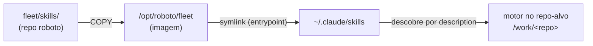
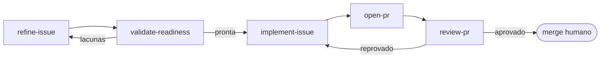

# Trilha C — Skills do fleet (como funciona)

> Documento **operacional** (como o sistema funciona hoje). O *porquê* / a investigação fica em
> [`research/C-design-de-skills.md`](https://github.com/CenturyBoys/roboto/blob/main/research/C-design-de-skills.md).
> **Princípio-âncora:** o procedimento do fleet (como refinar, validar, implementar, abrir PR, revisar)
> é um **artefato versionado e revisável**, não prompt escondido no código.
> **Status:** MVP no `main` — as 5 skills do loop em `fleet/skills/`, expostas ao motor e validadas no
> container. Follow-ups (empacotar como plugin, supply-chain de terceiros, mais skills) ficam no backlog.

## 1. O que a trilha entrega

As **convenções do fleet** empacotadas como **skills com progressive disclosure**: o motor carrega o
procedimento de um passo **só quando precisa** dele — pelo `description` da skill — em vez de carregar
um prompt gigante a cada turno. Antes essas regras viviam hardcoded nos prompts do orquestrador; agora
são **artefatos versionados, revisados por composição** (a skill é código). O *gate* continua no código
(determinismo primeiro); a skill é o **procedimento** que o motor segue até o gate.

## 2. Onde vivem (e por que separadas)

| Pasta | Pra quem | Descoberta pelo Claude Code |
|---|---|---|
| **`fleet/skills/`** (repo `roboto`) | o **motor** trabalhando em **repos-alvo** | via `~/.claude/skills` (global) |
| **`.claude/skills/`** (repo `roboto`) | quem trabalha **no próprio roboto** (`docs`, `github`) | via `.claude/skills/` do **cwd** |

**Por que separar:** o Claude Code descobre skills no `.claude/skills/` do **cwd** + no `~/.claude/skills`
global. O motor roda com `cwd` no repo-alvo (`/work/<repo>`) — então **não** enxerga o `.claude/skills/`
do roboto. Por isso as skills do fleet moram em `fleet/skills/` e são **expostas ao motor** por um
caminho que não depende do cwd: o `~/.claude/skills` da imagem.

## 3. Cadeia de exposição (repo → container → motor)

O `fleet/skills/` do repo é copiado pra imagem (`poc/Dockerfile`) e o entrypoint o **symlinka** pra
`~/.claude/skills` (`poc/entrypoint.sh`). Assim o motor acha as skills em **qualquer repo-alvo**, sem
copiar nada pro repo do cliente.

**Legenda.** `COPY` = build da imagem. `symlink` = runtime, no `poc-entrypoint`. O motor roda com `cwd`
no repo-alvo mas lê o `~/.claude/skills` **global** — por isso o symlink, e não uma cópia pro cwd.

## 4. O MVP — o loop do SDLC como skills

As 5 skills cobrem o núcleo do ciclo. Cada uma dispara pelo seu `description`; o gate real vive no
código (coluna "gate determinístico").

| Skill | Dispara quando | Gate determinístico |
|---|---|---|
| `refine-issue` | montar uma issue acionável lendo o repo (engine-scoped) | — (produz o corpo; DoR checa depois) |
| `validate-readiness` | decidir se a issue está pronta (DoR em 3 camadas) | `agents/review.check_issue_readiness` |
| `implement-issue` | codar a issue (escopo mínimo, testes, checks verdes) | `verify` (tier-1 + code-intel) |
| `open-pr` | abrir o PR (GitFlow + Conventional Commits + `Closes`) | hook `commit-msg` + validador |
| `review-pr` | revisar o PR (reviewer≠autor, findings estruturados) | `agents/review.aprovado_por_findings` |

**Legenda.** É o mesmo loop das trilhas A/B/D, só que o **procedimento** de cada caixa agora é uma skill
versionada. `validate-readiness` fecha com o gate de DoR (trilha A); `review-pr` com o veredito
determinístico (trilha D); o laço `reprovado → implement` é a correção da trilha B.

## 5. Versionamento, teste e supply-chain (antes de "valer")

- **Versão no frontmatter:** cada `SKILL.md` tem `version:`. Bump = o procedimento mudou.
- **Revisão por composição:** mudar uma skill é um PR revisado (reviewer≠autor) — a skill é código.
- **Teste antes de valer:** skill nova roda primeiro num repo-alvo de teste (PoC contra
  `arenavalendo`) e só então entra no fluxo.
- **Supply-chain:** skill de terceiro **não entra sem revisão** — mesma régua de qualquer dependência.

## 6. Relação com o código (fonte da verdade)

As skills **codificam** o que o orquestrador já faz (os prompts de `app/loops.py`, `app/pr_cycle.py`,
`agents/review.py`). A fonte da verdade do *gate* continua no **código** (determinismo primeiro: DoR por
regra, veredito por `aprovado_por_findings`); a skill é o **procedimento** que o motor segue até bater no
gate. Trocar o motor (adapter) não muda as skills; trocar a plataforma não muda o gate.
