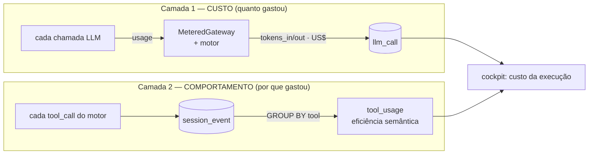

# Trilha F — Economia de token e ferramentificação (como funciona)

> Documento **operacional** (como o sistema funciona hoje). O *porquê* / a investigação fica em
> [`research/F-token-e-ferramentas.md`](https://github.com/CenturyBoys/roboto/blob/main/research/F-token-e-ferramentas.md).
> **Princípio-âncora:** a ferramenta certa custa **ordens de magnitude** menos token que grep-and-read.
> O LLM decide o *quê*; a ferramenta faz o *mecânico*; o harness **mede** — não por fé.
> **Status:** mecânico ligado + **medição em duas camadas** (custo e comportamento) no `main`.

## 1. O que a trilha entrega

Minimizar token por tarefa **sem perder qualidade**, promovendo operação repetida a **ferramenta
durável** (determinismo primeiro). O caso-guia é o **code-intel** (`ide_cc`): refactors e navegação
mecânicos viram tools verificadas por build, em vez de o motor ler arquivo inteiro e remontar a
operação em linguagem natural a cada turno.

## 2. O mecânico já ligado

| Peça | O que faz | Onde |
|---|---|---|
| **code-intel no motor** | 23 tools semânticas (refs, hierarquia, rename/move/extract verificados) | `runtime.py` monta o MCP se `ROBOTO_CODE_INTEL=1` (default) |
| **Base Rust** | `ripgrep` + `fd` na imagem (busca que respeita `.gitignore` → output menor) | `poc/Dockerfile` |
| **Regra de busca** | símbolos → code-intel; texto literal → ripgrep; **evitar** ler arquivo inteiro | prompt do motor |
| **Brief do code-intel (harness)** | injeta no prompt o **catálogo de tools puxado do próprio MCP** (`tools/list`, auto-mantido) + `repo_map` — reduz a NECESSIDADE de grep/Read cego | `app/code_intel_brief.py` |
| **`verify` harness-driven** | o harness chama o code-intel (não depende do modelo escolher) antes do PR | `app/verify.py` → trilha D |
| **Auto-format pré-commit (harness)** | o motor esquece de formatar e o pre-commit hook (`prettier --check`) barra o commit; o harness roda `prettier --write` nos arquivos alterados antes de commitar (determinismo, não depende do modelo). Best-effort: repo sem prettier → no-op | `app/autoformat.py` |
| **Registro de ferramentas** | `docs/TOOLS.md` pra o fleet não reinventar | `docs/TOOLS.md` |

## 3. Medir — não por fé (duas camadas)

O risco da economia de token é virar fé. Então o sistema mede em **duas camadas complementares**:

**Legenda.** A camada de **custo** já existia (`MeteredGateway` captura `usage` do OpenRouter e do
motor Claude Code → tabela `llm_call` com `tokens_in/out` e `cost_usd` por run/tier → view *Custos*).
A camada de **comportamento** é nova: cada ferramenta que o motor chama já é registrada como
`session_event` (kind `tool_call`); agregamos esses nomes num sinal de eficiência.

## 4. A telemetria de ferramentas (`app/tool_usage.py`)

Cada `tool_call` é categorizado pelo nome (determinístico, sem LLM):

| Categoria | Ferramentas | Leitura |
|---|---|---|
| **semantic** | `mcp__code-intel__*` | caminho **barato** (navegação/edição verificada) |
| **read_full** | `Read` | ler arquivo inteiro — **caro**, o que queremos evitar |
| **search** | `Grep`, `Glob` | busca textual |
| **edit** | `Edit`, `Write`, `NotebookEdit` | edição built-in |
| **shell** | `Bash` | comando de shell |
| **other** | demais | — |

**Eficiência semântica** = `semantic / (semantic + read_full)` — entre as ops de *olhar código*,
a fração que foi pelo caminho barato. `1.0` = sempre semântico (ideal); `0.0` = sempre arquivo inteiro
(desperdício); `None` quando não houve navegação (não dá pra opinar). Aparece no **detalhe da execução**
do cockpit, ao lado do custo (`data-testid=exec-tool-usage`): verde ≥70%, âmbar ≥40%, vermelho abaixo.

Assim a pergunta "o motor está sendo econômico?" vira um número **medido por run**, que alimenta o
modelo de custo (trilha L) e expõe regressão de comportamento (motor voltando a ler arquivo inteiro).

## 5. Fonte da verdade e follow-ups

O **custo** vive em `llm_call`; o **comportamento** em `session_event` (agregado em `tool_usage`). As
duas são medições determinísticas do harness, não estimativa.

**Follow-ups (backlog):** cache quente do índice do code-intel (container efêmero re-indexa por run —
trilha K); **orçamento** de token por tipo de agente (trilhas H/L); busca semântica AST+vetor além do
code-intel; context engineering (compaction / note-taking — trilha G).
