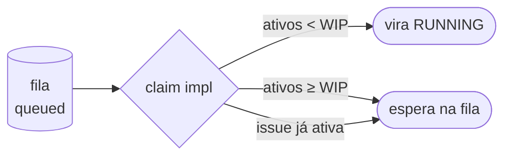
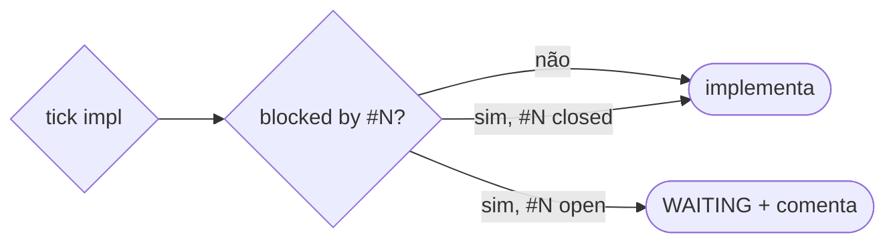

# Trilha J — Escala: fila, WIP e colisão (como funciona)

> Documento **operacional** (como o sistema funciona hoje). O *porquê* / a investigação fica em
> [`research/J-escala-ci-build-review.md`](https://github.com/CenturyBoys/roboto/blob/main/research/J-escala-ci-build-review.md).
> **Princípio-âncora:** quase tudo aqui é **política determinística**, não decisão de LLM.
> **Status:** concurrency-lock por issue + **WIP limit / backpressure** + **gate ciente de
> dependência** (`blocked by`) no `main`.

## 1. O que a trilha entrega

Políticas de escalonamento pra o fleet não virar fila infinita nem pilha de review a jusante quando
o volume cresce — **sem** gastar decisão de LLM nisso.

## 2. Serialização por entidade (já existente)

**Concurrency-lock por (tenant, issue)** (#165): no máximo **1 run ativo por issue** — dois eventos
da mesma issue não rodam em paralelo (evita dois agentes mexendo na mesma área = código que "se
cruza"). No Pg, advisory xact lock + `NOT EXISTS` de irmão ativo; no InMemory, o `busy` set.

## 3. WIP limit / backpressure (novo)

> *Sem backpressure, a fila converte todo impulso upstream em movimento downstream* — agentes abrem
> tarefas sobrepostas enquanto saídas anteriores seguem sem review/merge.

- **Cap global de runs ATIVOS por tenant** (`ROBOTO_WIP_LIMIT`; `0` = sem limite). Atingiu o teto →
  o `claim` de implementação **não pega novo** (fica `QUEUED` até abrir vaga). Determinístico, no
  `store.claim_next_queued(..., wip_limit=N)` (Pg: `COUNT` de ativos; InMemory: idem).
- Aplicado no **dispatch de implementação** (o trabalho delegado que paraleliza); refino/scope/revert
  são leves e não disputam o slot.
- **Visível no cockpit:** a aba **Monitor** mostra **ativos / limite** (trilha M) — o operador vê a
  frota contra o teto.

## 4. Gate ciente de dependência (novo)

> *Uma issue "blocked by #N" não pode ser implementada antes de #N existir* — senão o fleet coda em
> cima de algo que ainda não está no código (ou dois agentes colidem na mesma área).

- **Determinístico, do texto da issue.** `app/deps.py:blocked_by(título+corpo)` parseia referências de
  **bloqueio** — `blocked by #N`, `bloqueada por #N`, `depends on #N`, `depende de #N` (uma ou várias:
  `blocked by #79, #80`). **Não** confunde com `relaciona-se a / relates to / refs / Closes` — isso é
  só relacionado, não bloqueia.
- **No tick de implementação** (`process_pr_run_tick`): antes de delegar ao motor, consulta o estado de
  cada bloqueadora (`github.get_issue_state`). Se **alguma ainda está `open`** → comenta na issue
  (*"Bloqueada por #N (ainda aberta) — não implemento até ela fechar"*) e o run vai para **`WAITING`**
  sem gastar motor nem abrir PR. Fechou a bloqueadora → o próximo tick segue normalmente.
- **Por que no tick e não no claim:** o estado da bloqueadora muda no GitHub ao longo do tempo; checar
  no momento da execução evita segurar um slot e reflete o mundo real sem polling extra.

## 5. Fonte da verdade e follow-ups

A política vive no `claim`/tick (determinística, testada); o teto na config. A verdade do estado segue
na issue + git.

**Follow-ups (backlog):** **previsão de sobreposição** por arquivos/área da DoR; **merge queue** +
**test impact analysis** (two-step CI) + **quarentena de flaky** no lado do CI; conflito de merge =
gate humano (trilha H). O custo de LLM do review **não batcheia** → entra no modelo de custo (L).
