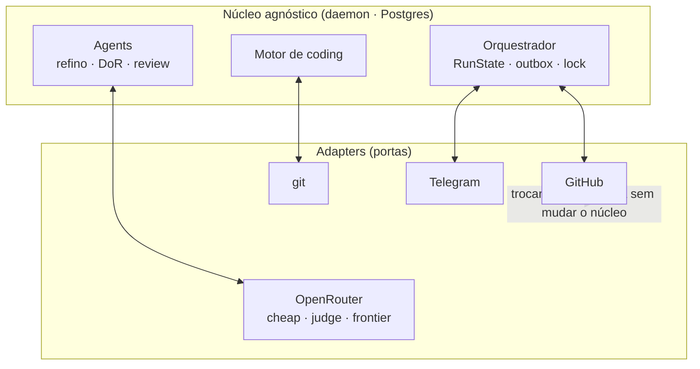

# Tutorial de dev / arquitetura

Para quem **mexe no código** do Potter. Pré-requisito: ler o [`AGENTS.md`](https://github.com/CenturyBoys/roboto/blob/main/AGENTS.md).

## 1. Princípios que moldam o código

- **Determinismo primeiro** — regra/código bem-feito > decisão de LLM. O CI é o juiz do "pronto".
- **Agnóstico de plataforma** — o núcleo (orquestrador, domínio) não conhece GitHub. GitHub é um
  **adapter**. O estado canônico vive no **daemon** (Postgres); labels/PRs são **projeções**.
- **Ports & adapters** — tudo que toca o mundo (GitHub, modelos, git, canal) é uma **porta** com
  adapter real + fake no teste. `Result[T, Error]` em vez de exceção no caminho feliz.



## 2. Mapa do código (`src/roboto/`)

| Caminho | O quê |
|---|---|
| `orchestrator/` | núcleo durável: `RunState`, `core` (ingest/claim/outbox/sweep), `pg_store`/`store` |
| `app/` | os laços e a lógica de aplicação (abaixo) |
| `agents/` | `refiner` (gera a issue), `review` (DoR + review de PR, determinístico) |
| `engines/` | `CodingEngine` (porta), `ClaudeCodeEngine`, `StubEngine` |
| `llm/` | `OpenRouterGateway` (tiers cheap/judge/frontier), STT |
| `github/` | `GithubAppClient` (adapter REST) + `webhook` |
| `channels/` | Telegram |
| `web/` | cockpit (ASGI console + SPA React em `web/ui/`) |

### `app/` — os laços
`engine_loop.drive_turn` (motor↔estado, com **watchdog** de inatividade), `pr_cycle` (ciclo
impl→PR→review→**corrige com resume**→re-review + o `process_correct_tick`), `loops` (refino com
self-check de DoR), `pr_poll`/`comment_poll` (gatilhos por **polling**), `issue_state` (projeta estado
→ label), `task_class` (tipagem de task + gate), `tiering` (right-sizing do modelo).

## 3. As trilhas (como funciona hoje)

- **[A — Contratos](trilha-a-contratos.md)**: DoR em 3 camadas, tipagem de task + gate,
  estado→label, templates.
- **[B — Orquestração](trilha-b-orquestracao.md)**: resiliência (retry/DLQ/lock/anti-loop/outbox),
  review determinístico, gatilhos por polling (`@potter` + check_suite).

## 4. Pontos de extensão

- **Nova plataforma** (GitLab/Jira): implemente os adapters (`list_open_prs`, `get_pr_diff`,
  `comment_pr`, `set_issue_state_label`, `list_recent_comments`…) — o núcleo não muda.
- **Novo motor de coding**: implemente `CodingEngine` (`engines/port.py`).
- **Roteamento de modelo**: `llm/openrouter.py` (tiers) + `app/tiering.py` (classe de tarefa).
- **Novo gatilho**: um tick em `app/*_poll.py` + fio em `runtime.py` (`run_periodic`).

## 5. Rodar os checks (tier-1)

```bash
pip install -e ".[dev]"
ruff check src tests && mypy && pytest
# front:
cd web/ui && npm ci && npm run build && npm test
```

!!! warning "Doc-in-sync"
    Mudança de regra/domínio exige **atualizar a doc no mesmo PR** (AGENTS §5). O CI roda o
    **doc-guard** (`scripts/doc_guard.py`): PR que mexe em `src/roboto/**` sem tocar `docs/` falha.
    Escape consciente: `[skip-docs]` no título do PR.

## 6. Convenções

- **Conventional Commits** (hook do repo), branch a partir de `main`, PR com `Closes #N`.
- **Nunca** `Co-Authored-By` / rodapé de ferramenta em commit ou PR (regra da org — AGENTS).
