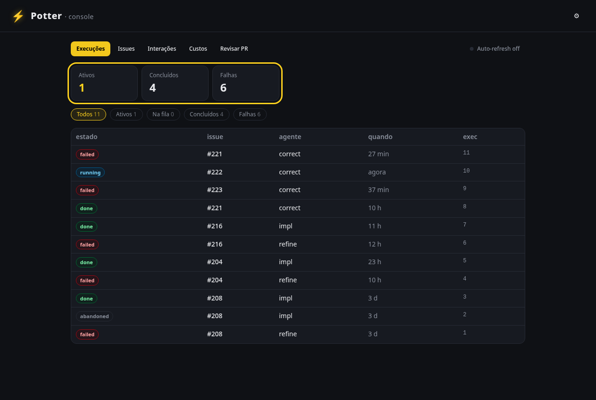

# Tutorial do operador — como usar o fleet

Para quem **opera** o Potter: subir, acompanhar e comandar o fleet. Não precisa mexer no código.

## 1. Pré-requisitos

- **Docker** + **docker compose**.
- Credenciais no `poc/.env.poc` (copie de `poc/.env.poc.example`): `GITHUB_API_TOKEN` (Contents+Issues+PR
  RW no repo-alvo), `OPENROUTER_API_KEY`, `TARGET_REPO_URL`/`ROBOTO_DEFAULT_REPO`, `CONSOLE_TOKEN`.

!!! tip "Guia completo de credenciais"
    Passo a passo de cada token está em `poc/TUTORIAL.md`.

## 2. Subir o fleet (PoC)

```bash
docker compose -f poc/compose.poc.yml --env-file poc/.env.poc up --build
```

Sobe: Postgres + daemon (cockpit + motor Claude Code via ccr→OpenRouter) + clona o repo-alvo em
`/work`. O container aplica as migrations sozinho.

- **Cockpit:** <http://localhost:8090> (cole o `CONSOLE_TOKEN` no menu ⚙).
- **Terminal web** (tmux do container): <http://localhost:7681>.

## 3. O cockpit

{ loading=lazy }

*A aba **Execuções** — torre de controle do fleet (screenshot gerado automaticamente; ver §8).*

| Aba | O que faz |
|---|---|
| **Execuções** | torre de controle: estado de cada run (cards-resumo + filtros). Clique p/ o detalhe (feed ao vivo, diff do PR, custos, chat). |
| **Issues** | lista as issues do repo-alvo; abre o detalhe pra refinar/implementar. |
| **Interações** | perguntas do motor que precisam de você (HITL). |
| **Custos** | tokens e $ por execução/modelo. |
| **Revisar PR** | revisa qualquer PR aberto; se reprova, aparece **🔧 Corrigir conforme o review**. |

## 4. O fluxo principal (issue → PR)

1. **Issues** → escolha uma → **Refinar com o motor** (o Claude lê o repo e propõe a issue
   fundamentada). Acompanhe no feed.
2. **📝 Aplicar** — grava o corpo refinado na issue (gate humano).
3. **▶ Implementar** — só com a issue **pronta (DoR)**. O motor coda, roda os checks e abre um **PR**
   em `develop`. Por dentro ele já **revisa (≠autor)** e **corrige** antes de te entregar.
4. **Revisar PR** / **Corrigir** — opcional, pra um PR específico.
5. **Merge** — é **seu** (gate humano). O fleet nunca mergeia sozinho.

!!! note "Gate de task"
    Uma task de **definição** (ADR/RFC, sem critérios) **não é codada** — o fleet avisa e fica em
    espera. Seu "done" é a spec aprovada.

## 5. Comandos por comentário — `@potter`

Em qualquer comentário de issue/PR do repo-alvo:

- `@potter refina` — dispara o refino.
- `@potter implementa` — dispara a implementação (se a issue estiver pronta).
- `@potter revisa` — revisa/corrige o PR.

O fleet **não precisa de conta de bot**: ele ignora os próprios comentários (marcador invisível) —
sem loop. Os comandos são lidos por **polling** (sem webhook).

## 6. Gatilhos automáticos

- **PR novo/commit** → após ~30 min estável (debounce), o fleet revisa; se reprova, corrige.
- **CI (check_suite) falhou** → o fleet antecipa a correção.

## 7. Acompanhando o estado

- Cada issue ganha uma label de estado: `status:in-progress` → `status:in-review` → `status:done`
  (ou `blocked`) — projetada automaticamente.
- No cockpit, **Auto-refresh** mantém a lista viva; o **feed** mostra cada passo do motor ao vivo.

## 8. Screenshots — documentação viva

As imagens deste tutorial são **geradas da UI real** (Playwright), não desenhadas à mão — então a
doc **não mente** sobre a tela. Com o cockpit rodando:

```bash
cd web/ui && npm ci && npx playwright install chromium
COCKPIT_URL=http://localhost:8090 CONSOLE_TOKEN=<seu-token> node scripts/screenshots.mjs
# -> regenera docs/assets/screens/*.png
```

Cada elemento tem um **`data-testid` estável** (`nav-execs`, `exec-summary`, `settings-toggle`…), então
o script consegue **destacar** exatamente a peça que a doc explica — e serve de âncora de
**conformidade** (o mesmo id vale pra teste e pra doc).

