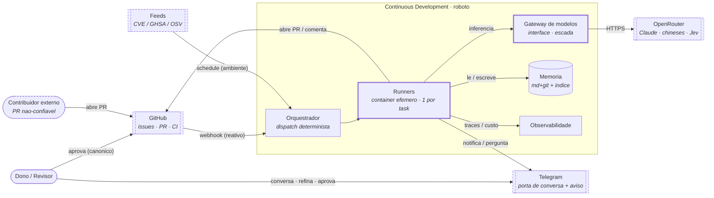
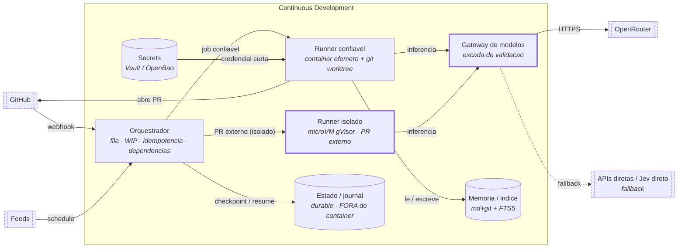
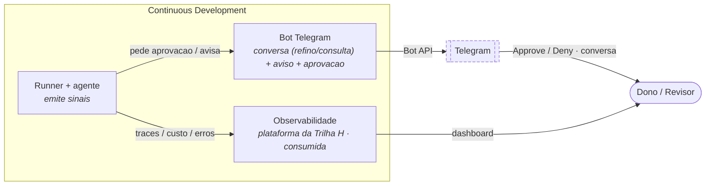
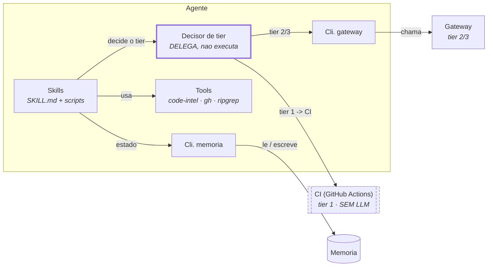
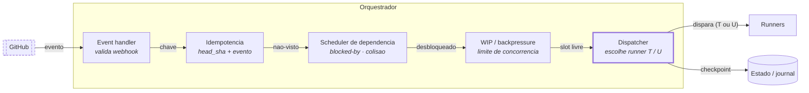
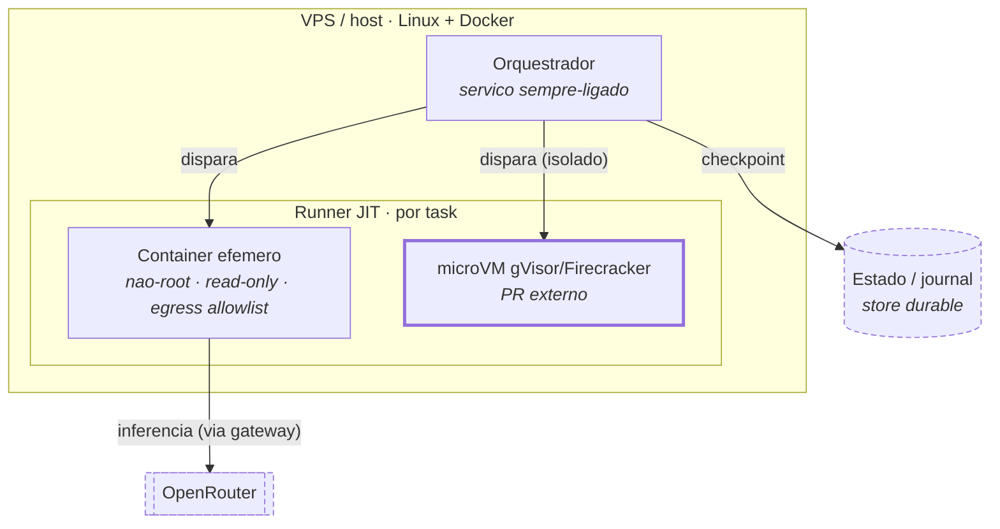
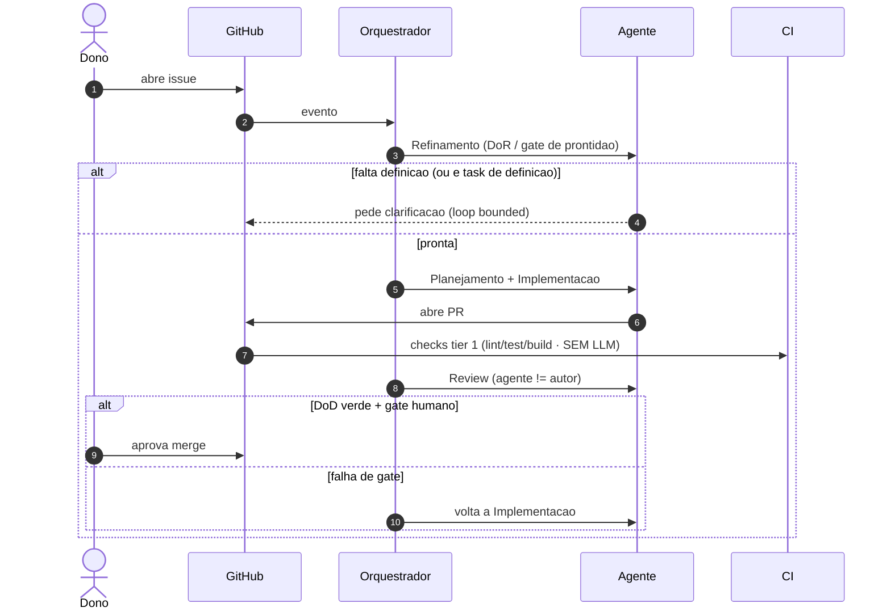
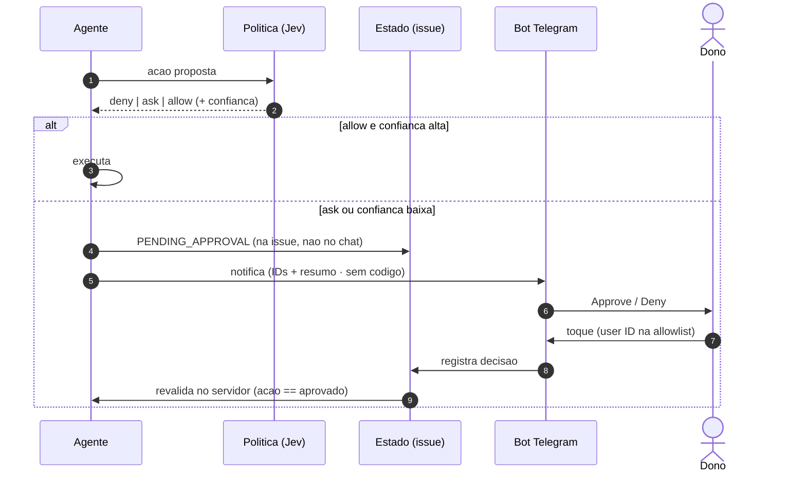
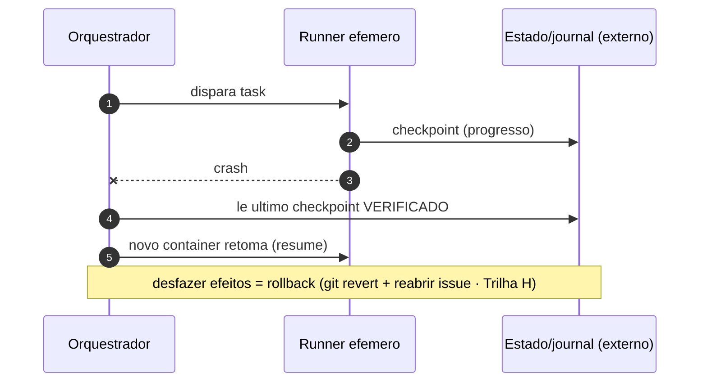

# Continuous Development · Diagramas C4

Diagramas em Mermaid, versionados — o estado atual do desenho. **Não é a fonte da verdade da
arquitetura**: em divergência, as **trilhas de pesquisa** (`research/*.md`) vencem para desenho e o
futuro `AGENTS.md`/código vence para implementação. Mudança de arquitetura começa no texto; o
diagrama acompanha.

Níveis C4: **contexto, contêineres, componentes** (do agente e do orquestrador), mais um
**deployment** e os **fluxos em sequência** — que é onde moram as decisões que um diagrama de caixas
não mostra.

> **Como ler os diagramas de caixa.** Os níveis são C4, mas o desenho usa **`flowchart`, não a
> notação `C4Container` do mermaid** — de propósito: o renderizador C4 do mermaid *não faz layout*
> (distribui numa grade fixa, e com descrição de mais de poucas palavras as caixas se sobrepõem e o
> texto sai de dentro). O flowchart passa pelo **dagre**, que posiciona de verdade — e é legível em
> tema claro ou escuro sem fundo colorido. Convenções: **contorno tracejado = fora do roboto**
> (externo); **contorno grosso = ponto sensível/novo** (ex.: runner isolado, o gateway, a porta
> única). Formas: `(["ator"])` pessoa · `[["sistema externo"]]` · `[("armazenamento")]`.

---

## Nível 1 · Contexto

**O que este nível decide (e por quê):**
- **Dois gatilhos, não um** (Trilha B): `gh → orch` é **reativo** (webhook); `feeds → orch` é
  **ambiente** (schedule) — o agente de Segurança nasce de feed, não de PR.
- **Telegram é porta de conversa, não só aviso** (Trilha M): refino de demanda e consulta ao
  backlog passam por aqui — mas a **verdade continua na issue** (o chat vira proposta).
- **OpenRouter é o único caminho de modelo** (Trilha I): tudo (Claude, chineses, Jev) entra por ele,
  atrás do **gateway** interno (contorno grosso) — é o que permite trocar provedor sem tocar o resto.

⚠️ O `contrib` (PR externo, tracejado) é o **vetor não-confiável**; onde ele cai muda tudo no nível 2.

---

## Nível 2 · Contêineres

### 2.1 · O caminho da task (execução e modelos)

### 2.2 · O caminho do humano (observabilidade e comunicação)

**As cinco coisas que este nível decide:**
1. **Orquestrador é processo determinístico** (Trilhas B/0) — fila, WIP, idempotência, grafo de
   dependências. Não é um agente; é a camada que coordena.
2. **Runner é efêmero, 1 por task + git worktree** (Trilha K) — paralelismo sem colisão de código.
3. **Dois perfis de runner** (⚠️, Trilha K): `rt` confiável (código nosso) e `ru` **isolado
   (gVisor/Firecracker)** para PR externo — **não é opcional-MVP**; a fronteira de confiança é estrutural.
4. **O estado durável vive FORA do container efêmero** (Trilha M) — por isso `orch → st`: um
   container novo **retoma do checkpoint externo** (resume ≠ rollback).
5. **Telegram ≠ observabilidade** (Trilha M): são contêineres distintos; a observabilidade é a
   **plataforma decidida na H** (consumida, não inventada aqui).

⚠️ **Gateway é contorno grosso porque é a única porta de modelo** — e tem `fallback` (tracejado) para
não virar ponto único (Trilha I). OpenRouter é **uma** implementação da interface.

---

## Nível 3 · Componentes do agente (dentro do runner)

⚠️ **A escada atravessa fronteiras — não é lógica interna do agente.** O **tier 1 é o CI (externo,
sem LLM)** e o **tier 3 é o Gateway (externo)**. O `Decisor de tier` (contorno grosso) só **decide e
delega** — se desenhássemos a escada inteira dentro do agente, sugeriríamos que ele roda os próprios
checks, violando "determinismo primeiro / CI é o juiz" (Trilhas 0/I).

## Nível 3 · Componentes do orquestrador

⚠️ **`idem` vem antes de `dep`**: entrega de evento é *at-least-once* (Trilha B) — deduplicar
**antes** de agendar evita disparar a mesma task duas vezes. E o `Dispatcher` (grosso) é quem
**roteia PR externo para o runner isolado** — a decisão de confiança do nível 2 mora aqui.

---

## Deployment · onde cada coisa roda

⚠️ **O estado durável é externo** (store, tracejado): o host/container pode morrer que o checkpoint
sobrevive. E o caminho de PR externo é a **microVM** (grosso), não o container padrão.

---

## Fluxo · Issue → PR → merge

## Fluxo · Gate de aprovação (Jev + Telegram, revalidado no servidor)

## Fluxo · Checkpoint / resume pós-falha

---

## As arestas-chave e o contrato de cada uma

Uma aresta está *definida* quando se sabe: quem inicia, o que carrega, como autentica, e o que
acontece na falha.

| Aresta | Inicia | Carrega | Autentica | Falha |
|---|---|---|---|---|
| GitHub → Orquestrador | evento | webhook | secret do webhook + dedupe (`head_sha`) | reentrega (at-least-once) |
| Feeds → Orquestrador | schedule | CVE/advisory | cron/feed | próxima janela |
| Orquestrador → Runner | orquestrador | task + contexto da issue | runner JIT | retoma do checkpoint |
| Runner → Gateway | agente | prompt/decisão | chave no secret store | fallback (APIs diretas / Jev direto) |
| Runner → GitHub | agente | PR / comentário | machine-user (escopo mínimo) | reabre issue / retenta |
| Runner → Telegram | agente | aviso / pergunta (IDs+resumo) | bot token + allowlist de user | perda tolerável (verdade na issue) |
| PR externo → Runner isolado | orquestrador | diff não-confiável | — | **isolamento forte obrigatório** (gVisor) |
| Agente → modelos | agente | prompt | OpenRouter (CTO) | fallback / degrada |

⚠️ **Assimetria do Telegram:** a mesma aresta serve *conversa de entrada* (refino/consulta) e
*aprovação* — mas **nenhuma delas é autoridade final**: toda mutação de estado é revalidada no
servidor contra a issue + política (Trilhas M/H). Telegram propõe; GitHub/issue decide.

---

## O que falta para fechar (lista de trabalho do alto nível)

| Elo | Fecha? | O que falta |
|---|---|---|
| Stack inicial do `roboto` (linguagem/framework) | **não** | fixa comandos/linter (E), ferramenta de impacto (J), base do runner (K) |
| Orquestrador (fila/idempotência/WIP) | **não** | peça central ainda não especificada em detalhe (B) |
| Gateway de modelos (interface + fallback) | **parcial** | interface desenhada; falta mapa operação→tier medido (I) |
| Runner isolado para PR externo | **não** | gVisor/Firecracker + roteamento por confiança (K) |
| Estado durável / checkpoint | **parcial** | leve (issue+git+journal) vs engine durável — decidir no MVP (M) |
| Plataforma de observabilidade | **não** | decisão única da H, consumida por M/L |
| Telegram (conversa + aprovação) | **não** | bot + allowlist + revalidação server-side (M) |
| Gates humanos (catálogo de ações) | **não** | lista explícita de "irreversível/alto impacto" (H) |
| Orçamento token/$ por agente/issue | **parcial** | teto = R$550/mês de API; falta baseline medido (L) |

---
Trilhas: estrutura 0/B/C/I/K · gates/observabilidade H/M · custo L · memória G · contratos A.
Processo macro: `SYNTHESIS.md`. Auditoria desta vista: `research/audits/auditoria-c4.md` (PR #19).
