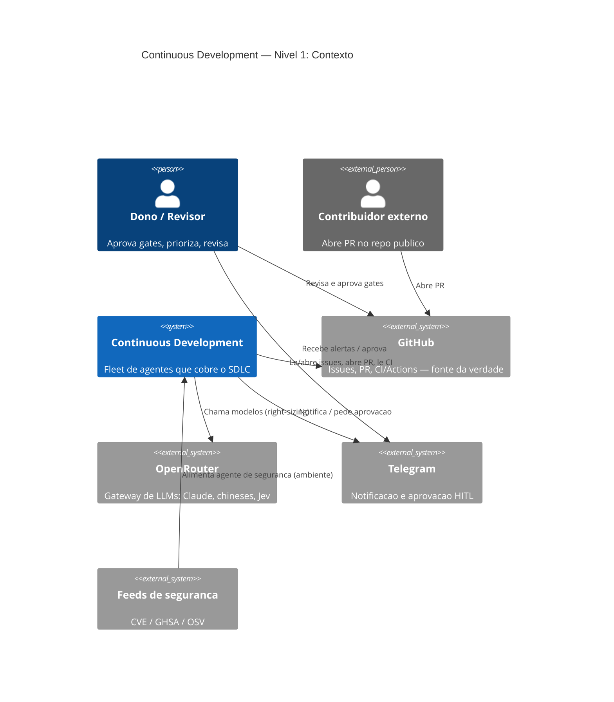
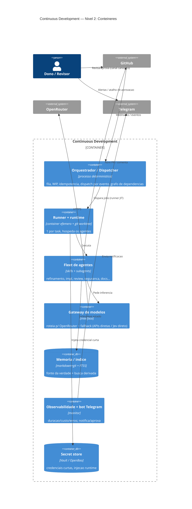
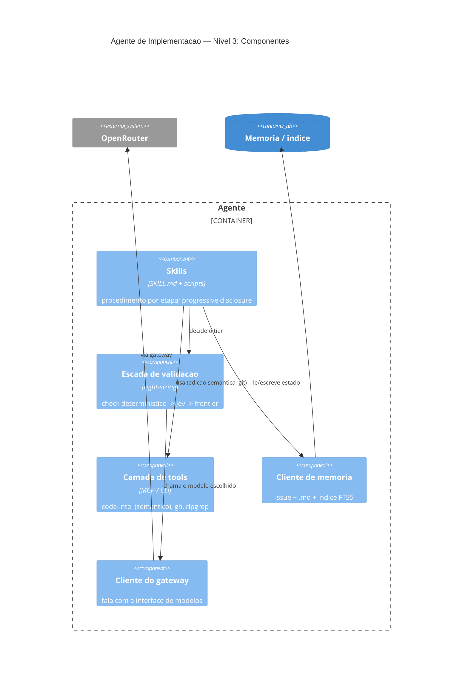

# Arquitetura — Vistas C4

> Fase: PESQUISA. Este doc traz as **vistas estruturais no padrão C4** (Context → Container →
> Component). Os diagramas de **processo/estado** (fluxo do SDLC, máquina de estados da issue,
> escada de validação) vivem em [`SYNTHESIS.md`](SYNTHESIS.md) — são **complementares**, não C4.
>
> **Nota de padronização (auditoria honesta):** até aqui os diagramas eram `flowchart`/`stateDiagram`
> (processo/estado). C4 descreve **estrutura de software**; por isso ele entra aqui para as vistas
> Contexto/Contêiner/Componente, e os de processo seguem no SYNTHESIS. O nível **Code** do C4 é
> substituído por **esboços ilustrativos** ao final (o que você pediu: exemplo das peças, p.ex. a LLM).

## C4 Nível 1 — Contexto do sistema



## C4 Nível 2 — Contêineres



## C4 Nível 3 — Componentes (zoom no Agente, ex.: Implementação)



## Nível 4 (Code) → Esboços ilustrativos das peças

> ⚠️ **Esboços** para comunicar o desenho — **não é código de produção** (fase de pesquisa).

### Peça: Gateway de modelos + escada de roteamento (a "peça da LLM")
```ts
// Interface: a arquitetura fala com ISTO, não com um provedor (desacopla do OpenRouter).
interface ModelGateway {
  deterministic(task): Result;            // (na verdade: nem chama LLM — ver escada)
  judge(task): { verdict: "deny"|"ask"|"allow"; confidence: number };  // Jev / jev-guard
  generate(task, model: string): { text: string; confidence?: number };
}

// Escada de validação / right-sizing (Trilha I)
async function routed(task): Result {
  if (task.isDeterministic) return runCheck(task);          // 1) lint/test/type/build — SEM LLM
  if (task.kind === "decision") return gateway.judge(task); // 2) Jev barato, confiança calibrada
  const cheap = await gateway.generate(task, pickCheapModel(task)); // 3) chinês/aberto
  return cheap.confidence! >= THRESHOLD ? cheap
       : gateway.generate(task, FRONTIER);                  //    escala a Claude só se preciso
}
// OpenRouter é UMA implementação de ModelGateway; fallback: APIs diretas / LiteLLM self-host / Jev direto.
```

### Peça: Gatilho (GitHub Actions → runner JIT no container efêmero)
```yaml
# .github/workflows/refine.yml  (esboço)
on: { issues: { types: [opened, edited] } }
jobs:
  refine:
    if: github.actor != 'roboto-bot'          # anti-loop (Trilha B): ignora o proprio bot
    runs-on: [self-hosted, roboto-ephemeral]  # runner JIT -> container 1-por-task (Trilha K)
    steps:
      - uses: ./.github/actions/run-agent
        with: { agent: refinamento, then: validate-readiness }  # gate de prontidao (Trilha A)
```

### Peça: Gate de aprovação (Jev + humano; GitHub canônico, Telegram notifica)
```ts
const v = gateway.judge({ action, context });   // deny | ask | allow + confidence
if (v.verdict === "deny") return abort(v);
if (v.verdict === "ask" || v.confidence < HUMAN_THRESHOLD) {
  persistState("PENDING_APPROVAL");              // estado na issue (A), nao no chat
  notifyTelegram(idsResumoSemCodigo);            // dados minimos (M); canal canonico = GitHub
  await waitApprovalRevalidatedServerSide();     // autoridade verificada no servidor (M/H)
}
```

---
Referências de trilha: estrutura em 0/B/C/I/K; gates/observabilidade em H/M; custo em L; memória em G.
Diagramas de processo/estado: `SYNTHESIS.md`.
