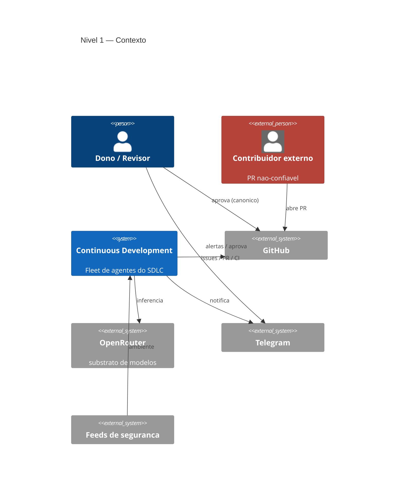
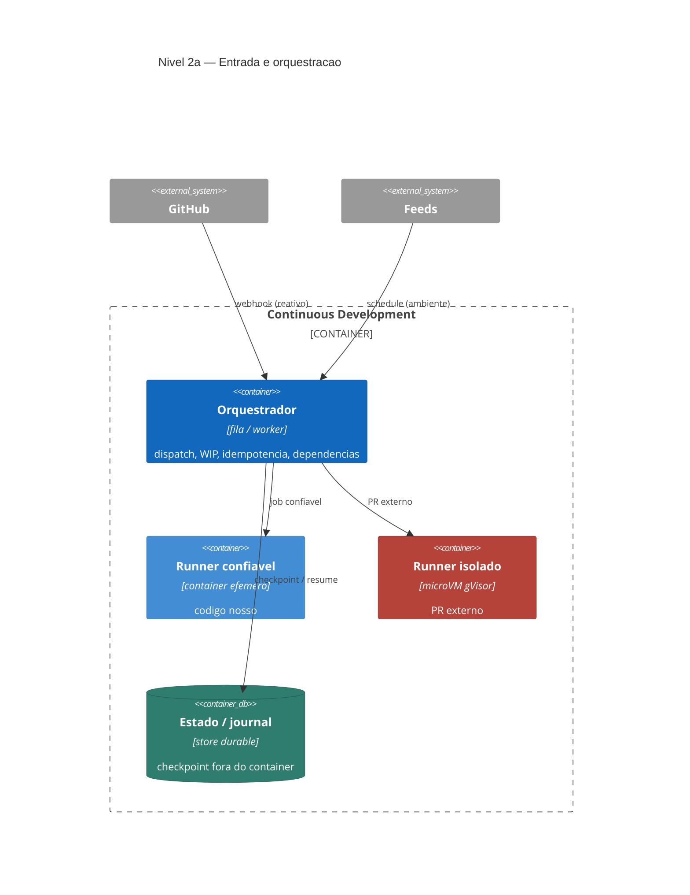
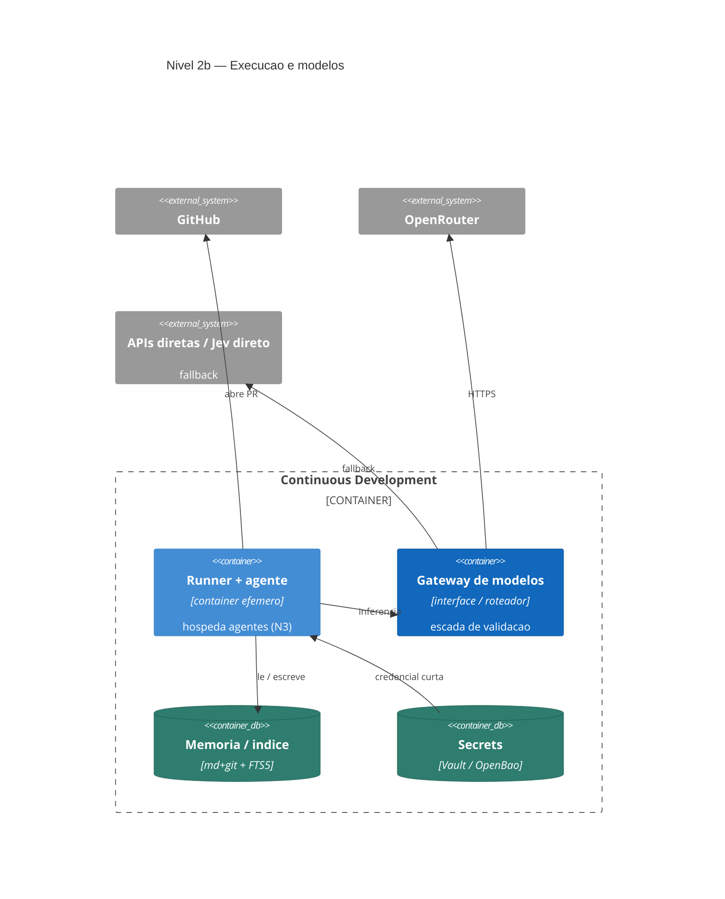
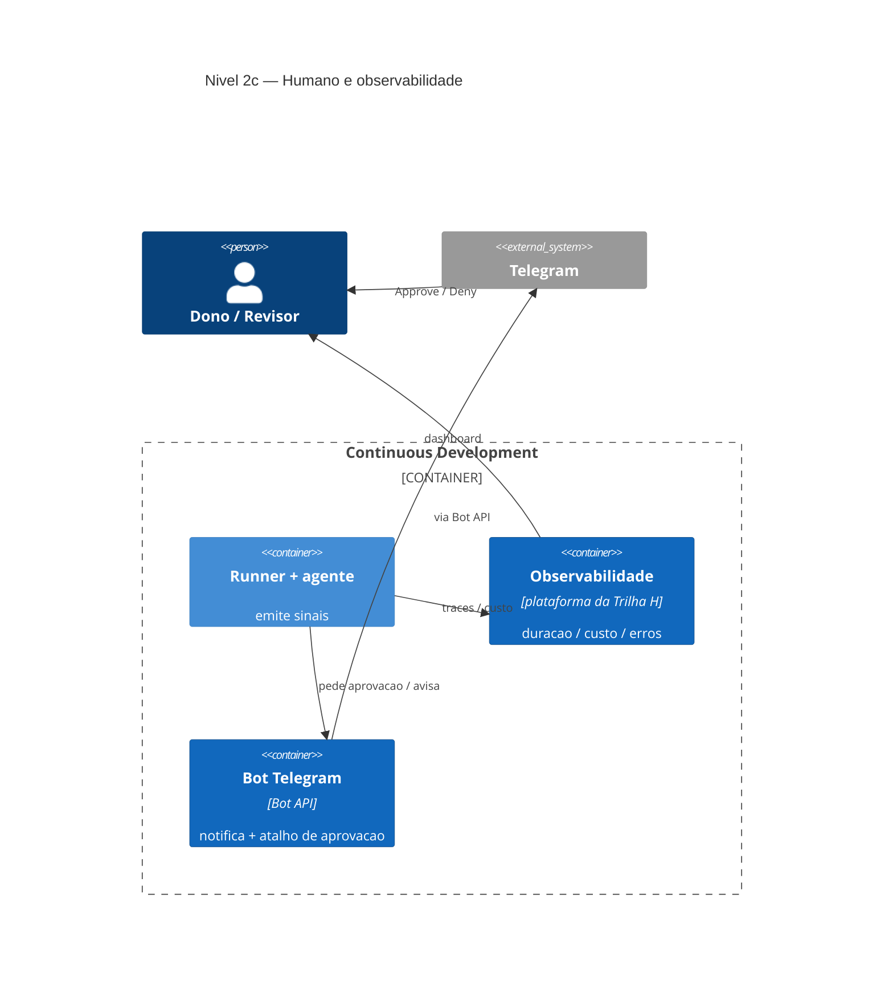
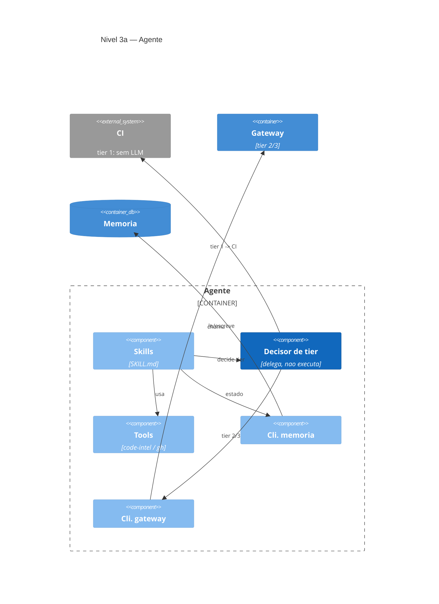
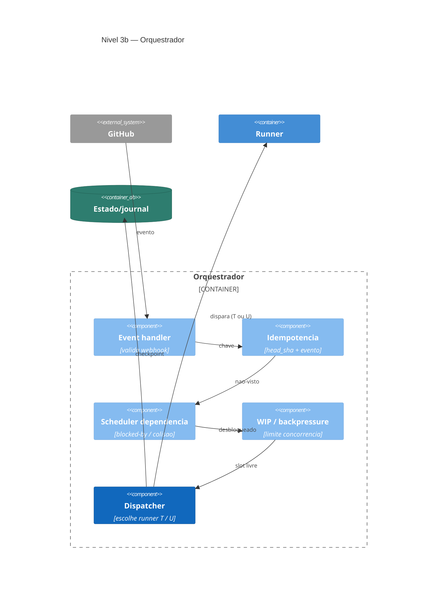
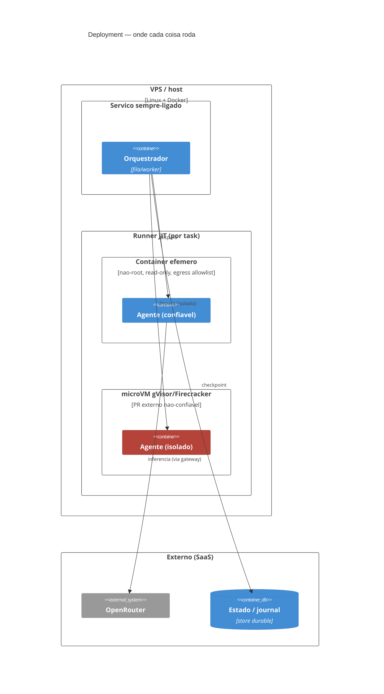
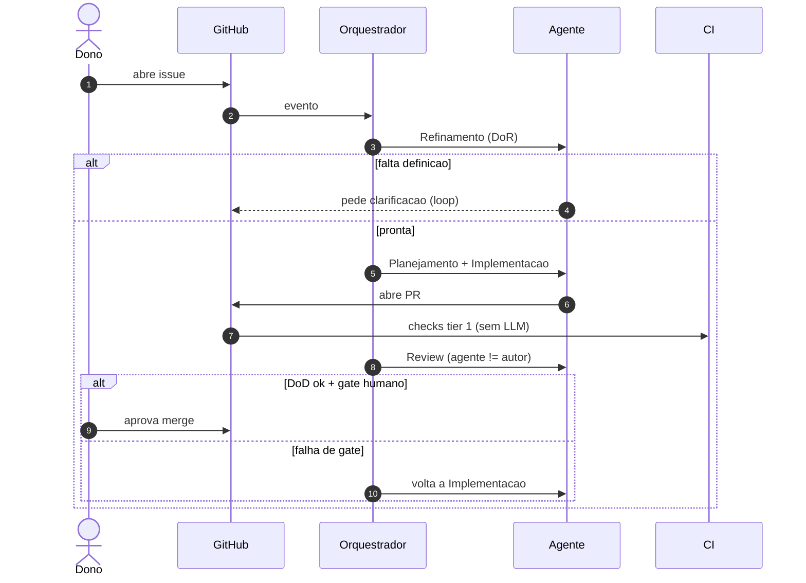
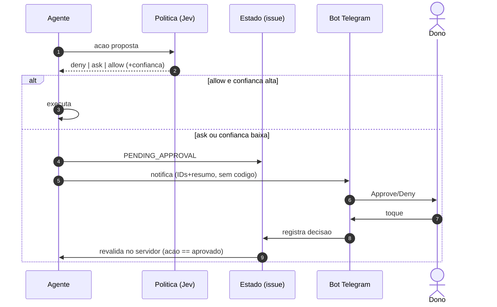
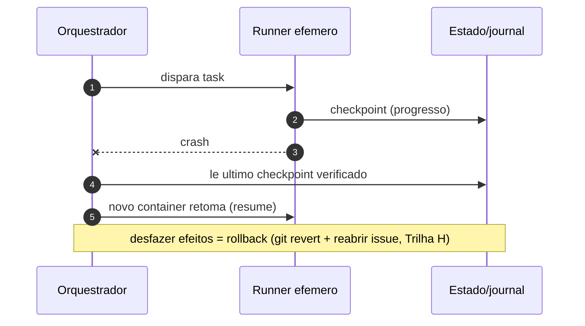

# Arquitetura — Vistas C4 + Sequências

> Fase: PESQUISA. **Rev. 4** — estilo (cores por tipo + layout) e **profundidade** (componentes do
> Orquestrador + vista de Deployment). Diagramas pequenos e focados. Correções da auditoria (PR #19) mantidas.
>
> Paleta: **azul** = nosso sistema/contêiner · **verde-água** = armazenamento · **cinza** = externo ·
> **vermelho** = fronteira não-confiável (isolamento forte). Render do mermaid varia por viewer.

---

## C4 Nível 1 — Contexto



---

## C4 Nível 2 — Contêineres (3 fatias)

### 2a · Entrada e orquestração


### 2b · Execução e modelos


### 2c · Humano e observabilidade


---

## C4 Nível 3 — Componentes

### 3a · Agente (dentro do runner)


### 3b · Orquestrador (interno) — profundidade


---

## C4 Deployment — runtime / infra (profundidade)



---

## Sequências (comportamento + decisões)

### S1 · Issue → PR → merge


### S2 · Gate de aprovação (Jev + Telegram, revalidado no servidor)


### S3 · Checkpoint / resume pós-falha


---

## Esboços de implementação (ilustrativos, não-produção)

<details><summary>Gateway + escada · gatilho anti-loop · gate de aprovação</summary>

```ts
interface ModelGateway {               // SÓ o que usa modelo; tier 1 NÃO é do gateway
  judge(task): { verdict: "deny"|"ask"|"allow"; confidence: number };   // Jev
  generate(task, model: string): { text: string; confidence?: number };
}
async function routed(task) {
  if (task.isDeterministic) return ci.run(task);                   // tier 1 — CI externo, sem LLM
  if (task.kind === "decision") return gateway.judge(task);        // tier 2 — Jev
  const cheap = await gateway.generate(task, pickCheapModel(task)); // tier 3a — chinês/aberto
  return cheap.confidence! >= T ? cheap : gateway.generate(task, FRONTIER); // tier 3b — Claude
}
```
```yaml
# anti-loop CORRETO (B): filtro por actor COM exceções + loop breaker — não filtro cego
on: { issues: { types: [opened, edited] }, pull_request: { types: [synchronize] } }
jobs:
  agent:
    if: ${{ github.actor != 'roboto-bot' || github.event.action == 'synchronize' }}
    runs-on: [self-hosted, roboto-ephemeral]
    steps:
      - run: assert-loop-budget --key "${{ github.event.issue.number }}" --max 5
      - uses: ./.github/actions/run-agent
```
```ts
const v = gateway.judge({ action, context });
if (v.verdict === "deny") return abort(v);
if (v.verdict === "ask" || v.confidence < HUMAN_THRESHOLD) {
  persistState("PENDING_APPROVAL");            // na issue (A), não no chat
  notifyTelegram(idsResumoSemCodigo);          // dados mínimos (M); gate canônico = GitHub
  await waitApprovalRevalidatedServerSide();   // autoridade no servidor (M/H)
}
```
</details>

---
Estrutura: 0/B/C/I/K · gates/observabilidade: H/M · custo: L · memória: G. Auditoria: `research/audits/auditoria-c4.md` (PR #19).
