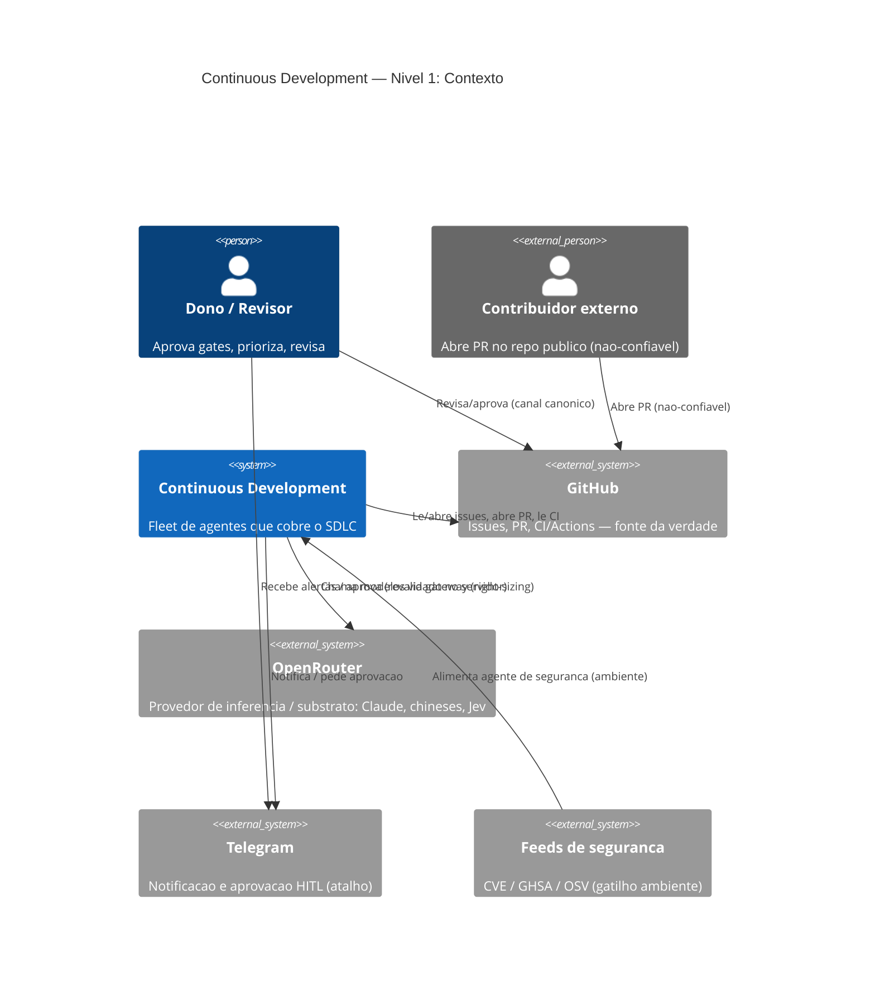
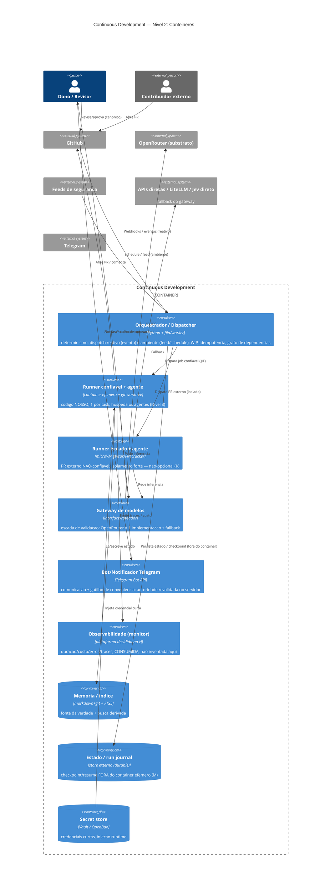
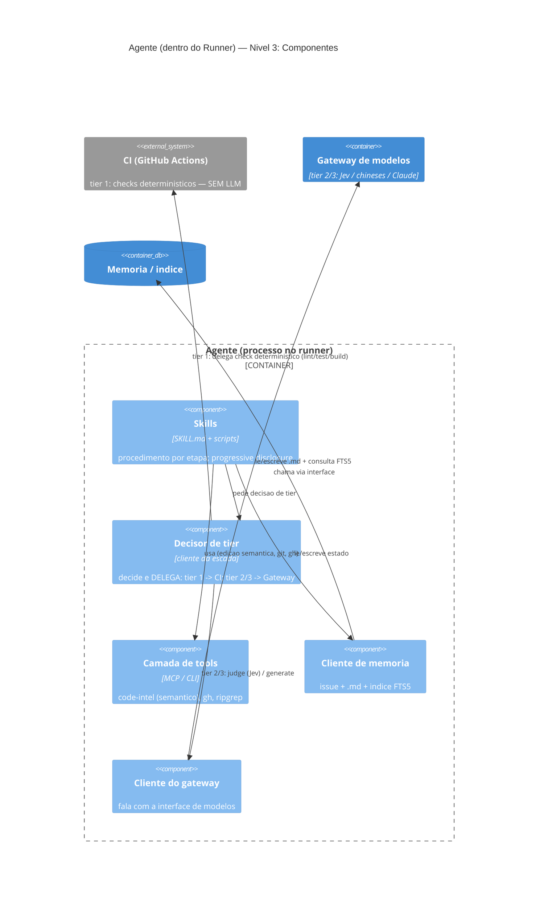

# Arquitetura — Vistas C4

> Fase: PESQUISA. Vistas **estruturais no padrão C4** (Context → Container → Component). Os
> diagramas de **processo/estado** (fluxo do SDLC, máquina de estados, escada) vivem em
> [`SYNTHESIS.md`](SYNTHESIS.md) — **complementares**, não C4.
>
> **Rev. 2** — corrigida após a auditoria `audit/architecture-c4` (`research/audits/auditoria-c4.md`,
> PR #19): agentes viraram **componentes dentro do runner** (não contêiner irmão); caminho de **PR
> externo não-confiável** com isolamento forte; feeds/ambiente, Telegram≠observabilidade, estado
> durável do orquestrador, fallback do gateway e rótulos de tecnologia ajustados.

## C4 Nível 1 — Contexto do sistema



> Nota (Trilha I): o externo é **OpenRouter como substrato/provedor** — a palavra "gateway" fica
> reservada ao **contêiner interno** (interface trocável). Jev também tem **API direta** (fallback).

## C4 Nível 2 — Contêineres



## C4 Nível 3 — Componentes (zoom no agente, dentro do runner)



> **Determinismo primeiro**: o **tier 1 é o CI (externo)**, não lógica do agente; o **tier 3 vai pelo
> Gateway (externo)**. O componente interno só **decide o tier e delega** — não "roda os próprios checks".

## Nível 4 (Code) → Esboços ilustrativos das peças

> ⚠️ **Esboços** para comunicar o desenho — **não é código de produção** (fase de pesquisa).

### Peça: Gateway de modelos + escada (a "peça da LLM")
```ts
// A interface do gateway cobre SÓ o que usa modelo. O tier 1 (determinístico) NÃO é do gateway.
interface ModelGateway {
  judge(task): { verdict: "deny"|"ask"|"allow"; confidence: number };   // Jev / jev-guard
  generate(task, model: string): { text: string; confidence?: number };
}

async function routed(task): Result {
  if (task.isDeterministic) return ci.run(task);            // tier 1 — CI EXTERNO, sem LLM (não é do gateway)
  if (task.kind === "decision") return gateway.judge(task); // tier 2 — Jev barato, confiança calibrada
  const cheap = await gateway.generate(task, pickCheapModel(task)); // tier 3a — chinês/aberto
  return cheap.confidence! >= THRESHOLD ? cheap
       : gateway.generate(task, FRONTIER);                  // tier 3b — Claude só se difícil/baixa confiança
}
// OpenRouter é UMA implementação de ModelGateway; fallback: APIs diretas / LiteLLM self-host / Jev direto.
```

### Peça: Gatilho (GitHub Actions → runner JIT) — anti-loop correto (Trilha B)
```yaml
# .github/workflows/agent.yml  (esboço)
on:
  issues: { types: [opened, edited] }
  pull_request: { types: [synchronize] }   # loop DESEJADO fix->review
jobs:
  agent:
    # B: NÃO é filtro-por-actor cego. Ignora eventos do bot EXCETO os que alimentam o loop
    # desejado (bot commita -> CI -> bot corrige); + loop breaker bounded por issue/PR.
    if: ${{ github.actor != 'roboto-bot' || github.event.action == 'synchronize' }}
    runs-on: [self-hosted, roboto-ephemeral]       # runner JIT -> container 1-por-task (K)
    steps:
      - run: assert-loop-budget --key "${{ github.event.issue.number }}" --max 5   # loop breaker (B)
      - uses: ./.github/actions/run-agent
        with: { agent: refinamento, then: validate-readiness }   # gate de prontidão (A)
```

### Peça: Gate de aprovação (Jev + humano; GitHub canônico, Telegram notifica)
```ts
const v = gateway.judge({ action, context });   // deny | ask | allow + confidence
if (v.verdict === "deny") return abort(v);
if (v.verdict === "ask" || v.confidence < HUMAN_THRESHOLD) {
  persistState("PENDING_APPROVAL");              // estado na issue (A) / store durável (M), não no chat
  notifyTelegram(idsResumoSemCodigo);            // dados mínimos (M); canal canônico = GitHub
  await waitApprovalRevalidatedServerSide();     // autoridade verificada no servidor (M/H)
}
```

---
Referências de trilha: estrutura em 0/B/C/I/K; gates/observabilidade em H/M; custo em L; memória em G.
Diagramas de processo/estado: `SYNTHESIS.md`. Auditoria desta vista: `research/audits/auditoria-c4.md` (PR #19).
