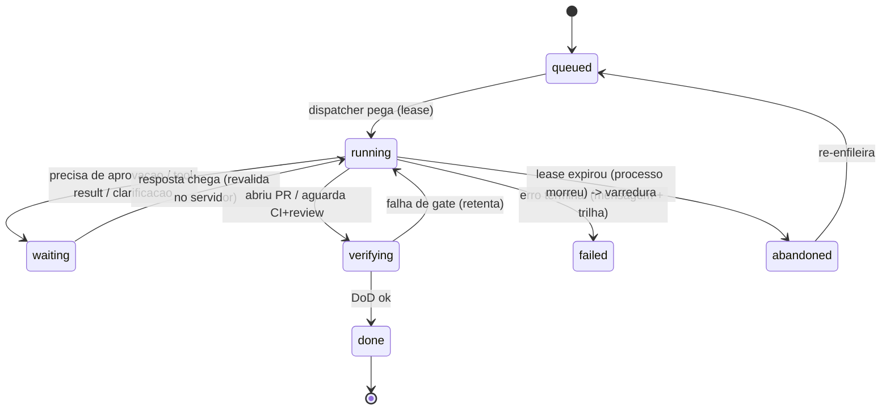

# Design do núcleo durável (§2 — D8/D9/D10/D11)

> Fase: PESQUISA. Isto é **design** (não pesquisa de mercado): o núcleo de durabilidade que o
> Orquestrador precisa. Estende B (ciclo/idempotência/outbox), M (checkpoint/resume), H
> (auditoria/observabilidade), L (custo), E (versão de AGENTS.md). Inspirado no padrão de turno do
> exemplo viva. **Schema real vive em código + migrations** (determinismo primeiro); aqui está o
> **modelo lógico**, a validar na implementação.

## D8 · Ciclo de vida do run (máquina de estados no banco)

Um **run** é uma execução de agente sobre uma issue/PR. É uma **máquina de estados persistida no
banco**, não uma requisição em voo — um reinício do processo no meio **não** pode perder trabalho em
silêncio.

**Regras (invariantes):**
- **Estado gravado ANTES de qualquer chamada externa** → crash é recuperável (resume de estado verificado, H).
- O gatilho responde rápido (ex.: 202); o run continua no processo; uma **varredura** periódica
  reclama runs com **lease expirado** (`abandoned`) — é o que D3 (checks periódicos) sustenta.
- `waiting` nunca vive no chat: o estado é o banco/issue (M).

## D8 · Idempotência + lock + "reconferir dentro do lock"

- **Idempotency key por arquitetura** (B): GitHub Actions = `head_sha + tipo de evento + nº`;
  webhook server = `X-GitHub-Delivery`. Grava a chave **antes** de processar; se já vista, descarta.
- **Serialização por issue/PR** (lock / advisory lock / concurrency group).
- ⚠️ **"o lock serializa a rajada, não a elimina"** → ao adquirir o lock, **reconferir o estado**
  (o run ainda está `queued`/`running`?). Quem esperava no lock, sem a segunda checagem, refaz o
  trabalho que o outro já fez. (No exemplo viva: 32 tarefas concorrentes → 32 chamadas de token onde
  devia haver 1.)

## D9 · Outbox / efeitos exactly-once

Ações com **efeito colateral** (abrir PR, notificar Telegram, publicar evento) não podem ser
"gravar e depois chamar" nem "chamar e depois gravar" — as duas quebram em falha no meio.

- **Padrão outbox**: o que será efetuado é **gravado na MESMA transação** do estado. Um publicador lê
  a tabela e efetua no próprio ritmo; o consumidor **deduplica** (dedup key). Ou tudo, ou nada.
- **Ordem obrigatória: gravar → commit → publicar/efetuar.** Efeito antes do commit faria a entrega
  virar a fonte da verdade. (Ex.: `PUBLISH` no Redis para "ao vivo" fica **fora** da transação —
  não há publish transacional; por isso grava-se antes e publica-se depois.)
- Cobre: PR aberto, notificação Telegram (M), eventos entre agentes/serviços.

## D10 · Auditoria `llm_call`

**Um único ponto fala com modelo** (o Gateway/orquestrador) → **um único ponto grava o custo**. Sem
isso, "economia de token" (L) e observabilidade/reprodutibilidade (H) não são verificáveis.

Registro por chamada de modelo: `run_id · tenant · repo · provider · model · tier · tokens_in ·
tokens_out · custo · latency_ms · prompt_version · agents_md_sha · skill_version · confidence ·
outcome · at`.

## D11 · Versão de prompt / AGENTS.md por run

Cada run **carimba** quais versões rodaram (sha do `AGENTS.md`, versão do prompt/skill) — responde
"qual regra/guia falou no run X" **sem reconstruir histórico**. São campos no `run` + no `llm_call`
(liga direto ao D10). AGENTS.md é versionado por git (E).

## Modelo lógico (ilustrativo — schema real = código + migrations)

| Tabela | Campos-chave | Papel |
|--------|--------------|-------|
| `run` | id, tenant, repo, issue_id, agent, **state**, attempt, **lease_until**, idempotency_key, agents_md_sha, prompt_version, created_at, updated_at | máquina de estados do run (D8/D11) |
| `run_event` | id, run_id, type, data, at | **run journal** (trilha/resume · M) |
| `outbox` | id, run_id, kind, payload, **dedup_key**, status(pending/sent), created_at, sent_at | efeitos exactly-once (D9) |
| `llm_call` | id, run_id, tenant, repo, provider, model, tier, tokens_in/out, cost, latency_ms, prompt_version, agents_md_sha, skill_version, confidence, outcome, at | auditoria/custo (D10/D11) |

> `tenant` em toda tabela = isolamento por empresa (D17). O índice de memória (FTS5) e o `.md` de
> memória (G) ficam fora deste núcleo transacional (storage≠search).

## Invariantes do núcleo (resumo)
1. Estado gravado **antes** do efeito externo.
2. **Reconferir dentro do lock** (serializa a rajada, não elimina).
3. **gravar → commit → publicar** (outbox; nada de efeito antes do commit).
4. **Resume só de estado verificado** (H); resume ≠ rollback (`git revert`, H).
5. **Um único ponto fala com modelo** e grava `llm_call`.
6. `tenant` em tudo (D17).

## Amarrações
B (ciclo/idempotência/outbox) · M (checkpoint/resume/Telegram via outbox) · H (auditoria/observab./
resume verificado) · L (custo via `llm_call`) · K (estado durável fora do container efêmero) · E
(versão de AGENTS.md) · D17 (tenant em tudo).
