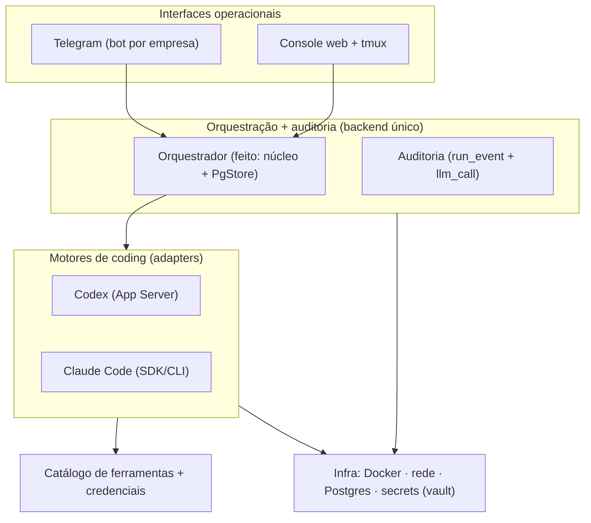

# Trilha N · Operação interativa + motores de coding

> **Origem:** spec do dono (2026-10-19) — "Visão geral da arquitetura" (§1–§8). Esta trilha
> **incorpora** esse doc, reconcilia com as decisões existentes (D1–D20) e mostra **onde cada
> requisito entra na jornada de build** (READINESS). Decisões novas: **D21–D26** (ver
> `DECISOES-A-FECHAR.md` §4).
> ⚠️ O doc de origem chegou **cortado no §8** ("Separação dos registros") — a modelagem de
> auditoria (D26) fica **parcial** até o restante do §8 ser colado.

## 1. As cinco responsabilidades (e onde já estão)

**Princípio reforçado:** Telegram e console **compartilham o mesmo backend** — nenhum mantém estado
próprio nem regra própria de roteamento. Isso é exatamente o **núcleo agnóstico de canal** (D20) que
já começamos: canais são adapters finos; a verdade e as regras vivem no orquestrador/GitHub.

## 2. Reconciliação — requisito do doc → o que já temos → onde entra

| Doc | Requisito | Já coberto? | Novo / decisão | Entra na jornada (READINESS) |
|-----|-----------|-------------|----------------|------------------------------|
| §1 | Infra (Docker/rede/DB/secrets) | ✅ D3 · D4 · D17 · K | — | **Passo 1 (feito)** |
| §1 | Catálogo de ferramentas + credenciais | parcial (D19 data-gateway · F) | **D22-adjacente** (registro formal por ambiente) | Junto dos motores (passo 3) |
| §1 | Agentes de coding (Codex, Claude Code) via adapters | só esboço (porta `Runner`, K) | **D22 (MAJOR) + PoC** | **Passo 3** (runner real) — PoC antes |
| §1 | Orquestração + auditoria | ✅ núcleo feito (PR #20/#21) · D8–D11 | D26 estende auditoria | **Passo 2 (feito)** + transversal |
| §1 | Telegram | ✅ adapter feito (PR #22) · M · D20 | D21 (bot/empresa) | Passo 2 (transporte) / 5 |
| §1 | Console web | ❌ | **D25 (novo)** | **Passo 5/6** |
| §1 | Mesmo backend p/ Telegram + console | ✅ princípio D20 | — | — |
| §2 | **Bot por empresa**, tenant derivado do servidor | parcial (adapter já vincula token→tenant) | **D21 (refino de D20/D17)** | **Passo 2** (transporte) |
| §3 | Registro de motores + **contrato comum** de adapter | porta `Runner` (stub) | **D22 (MAJOR)** | **Passo 3** |
| §4 | Várias execuções no mesmo chat · roteamento por **reply** | ❌ | **D24 (parte)** | Passo 3/5 |
| §5 | IDs **session / execution / interaction** | `Run`≈execution; falta session+interaction | **D23 (schema, migração 0002)** | **Precede passo 3** (fundação de dados) |
| §6 | `request_human_input` + `AWAITING_HUMAN` + concorrência/expiração | estado `waiting` existe; falta protocolo+entidade | **D24 (novo)** — usa **outbox (D9)** | Passo 3/5 |
| §7 | Console web + **terminal tmux** (ttyd/Wetty) | ❌ | **D25 (novo)** | Passo 5/6 |
| §8 | Auditoria completa (taxonomia de eventos) | base `run_event` (D8) + `llm_call` (D10) | **D26 (estende)** — *parcial, doc cortado* | Transversal (passo 2–3) |

## 3. O reframe mais importante: motor de coding ≠ chamada de modelo

Hoje temos **duas abstrações diferentes** e ambas são certas:
- **`ModelGateway`** (feito) — chamada **primitiva** de LLM (refino, judge, passos curtos). Fica.
- **`EngineAdapter`** (evolução da porta `Runner`, K) — **dirige um motor de coding externo**
  (Codex App Server / Claude Code SDK) que roda no container efêmero, tem **sessão própria**, usa
  ferramentas, **faz perguntas**, pede **aprovação** e **retoma**. É isto que o §3 do doc descreve.

O **contrato comum** (§3) que o `EngineAdapter` deve expor, conforme o motor suportar:
iniciar/acompanhar execução · stream de eventos/mensagens · erros/resultados · pedir
esclarecimento/decisão (`request_human_input`) · aprovar operação · **retomar após interação** ·
mapear **sessão nativa ↔ sessão interna** · encerrar/cancelar/recuperar.

> **Ponto de validação (§3 do doc):** a cobertura de *perguntas / aprovações / retomada* varia por
> ferramenta, versão e modo de execução. **Exige PoC antes de fixar o contrato** (ver §5).

## 4. Protocolo de interação humana (D24) — como casa com o que já construímos

- `AWAITING_HUMAN` do doc **=** nosso estado `waiting` (máquina de estados no banco). "Não ocupar
  worker" ✅ já é o desenho (estado sobrevive a restart; sweeper/lease cuidam de abandono).
- **Pergunta é um efeito** → sai pelo **outbox (D9)** (`telegram_notify`/console), com `dedup_key`.
- **Roteamento por reply (§4):** ao publicar a pergunta, guardar o **`message_id` do Telegram** na
  `interaction`; a resposta em *reply* usa esse id para achar a interação certa → valida autz →
  entrega ao `EngineAdapter` da execução dona. **Nunca** inferir destino pelo texto.
- **Out-of-flow (§6):** reply a pergunta já respondida · sem reply com N pendentes · duplicata do
  Telegram · expirada/cancelada · dois respondentes · sem autorização → **primeira resposta válida
  vence** (política de concorrência); demais rejeitadas/sinalizadas; **sem resposta ≠ aprovação**.
  Quando o destino não for seguro, o bot **pede esclarecimento** — não escolhe por inferência.
- Amarra com H ("output = proposta, política decide"), D7 (gate humano) e D15 (GitHub canônico;
  Telegram/console = atalho **revalidado no servidor**).

## 5. PoC que destrava D22 (motores) — antes de codar o runner real

1. **Claude Code (SDK/CLI):** start programático, stream de eventos, hook de permissão/aprovação,
   `request_human_input` equivalente, resume/sessão. *(dá pra levantar com o agente `claude-code-guide`.)*
2. **Codex (App Server):** mesma matriz de capacidades.
3. Saída = **matriz de cobertura** (o que cada motor faz nativo vs o que o orquestrador supre) →
   fixa o mínimo do contrato `EngineAdapter` + o que degrada graciosamente por motor.

## 6. Jornada revisada (inserções no READINESS)

- **Passo 2 (orquestrador, em curso):** + **GitHub App** (transporte) + **D21** (bot↔empresa, tenant
  do servidor) + wiring do **outbox** (materializar `IssueDraft`→issue).
- **Passo 2.5 (novo — fundação de dados interativa):** **D23** = migração `0002` com
  `session`/`execution`(=run)/`interaction` + mapa de **sessão nativa**. **Precede** interação humana.
- **Passo 3 (loop núcleo):** **D22** (EngineAdapters Codex/Claude Code, **após PoC**) + **D24**
  (request_human_input + roteamento por reply). Refiner materializa issue (join com GitHub App).
- **Passo 5 (humano):** **D25** console web + terminal tmux (ttyd/Wetty), autenticado/isolado por
  empresa; UI das interações pendentes.
- **Transversal (passo 2–3):** **D26** auditoria (taxonomia de eventos correlacionada aos IDs).

## 7. Perguntas em aberto (para o dono)
1. **§8 cortado** — cole o restante ("Separação dos registros" em diante) para fechar D26 (modelo de
   auditoria: store operacional "quente" vs log de auditoria "frio"?).
2. **D22/PoC:** quer que eu rode a matriz de capacidades (Claude Code + Codex) **já**, como próximo
   passo, ou primeiro fecho GitHub App + outbox (passo 2)?
3. **D25 console:** stack do front (ex.: FastAPI + HTMX simples vs SPA) — decidir ao chegar no passo 5.
