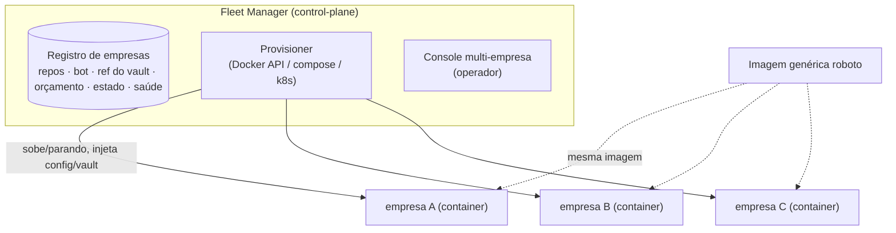

# Trilha N4 · Plano de controle multi-empresa (fleet manager) — D27

> Camada **acima** do D17 (1 instância por empresa). Responde: "com várias empresas, dá pra ter uma
> imagem genérica + um gerenciador com todo o registro e config?". Sim — **1 imagem, N containers**,
> coordenados por um control-plane. **Pós-PoC** (o PoC valida 1 empresa primeiro).

## Princípio
**Uma imagem genérica → N containers** (1 por empresa). A mesma imagem `roboto` sobe pra qualquer
empresa; o que muda é a **config/vault** injetada (o `load_config` já é "1 tenant por processo", D17).
**Nunca** gerar uma imagem por empresa (rebuild + registry inflado + drift). Config = dados, não build.

## Componentes

- **Registro de empresas:** catálogo (nome/tenant, repos, bot do Telegram, **referência** ao vault,
  teto de orçamento, estado, saúde). Guarda **ref** ao segredo, não o segredo (vault por empresa, D4).
- **Provisioner:** cria/para/reinicia o container da empresa a partir da imagem genérica, injetando
  o env/vault daquela empresa. Backends possíveis: Docker API (simples), compose, k8s (escala).
- **Supervisão:** health/restart, limites de recurso por empresa, teto de orçamento (L) por tenant.
- **Console multi-empresa:** o operador vê/admin todas as empresas; cada **instância** já tem seu
  console por-empresa (D25) — o manager agrega.

## Como casa com o que já temos
- `load_config` (env←vault) + 1 tenant/processo (D17) → **já** permite N containers da mesma imagem.
- Isolamento forte (dados/segredos/orçamento por empresa) mantido: nada compartilhado entre tenants.
- O manager é **stateful** (registro) e **de controle** — não processa trabalho de agente; delega aos
  containers por-empresa.

## Fora de escopo do PoC
O PoC valida **1 empresa** (arenavalendo). O manager entra **depois** de o loop vivo fechar numa
empresa — aí generaliza pra várias. Decisões a fechar no build: backend de orquestração (Docker API
vs k8s), modelo do registro (tabela/arquivo), e como o manager lê o vault por empresa.
