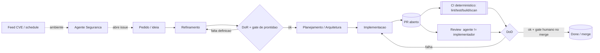
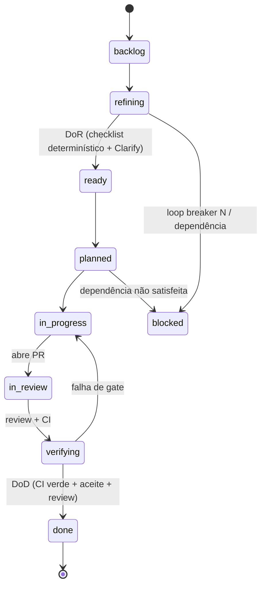
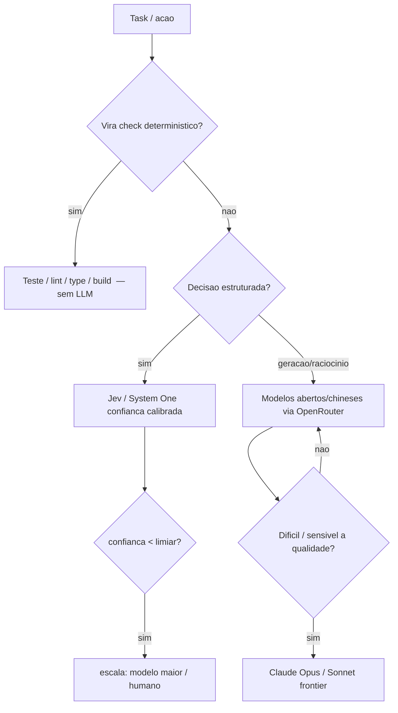
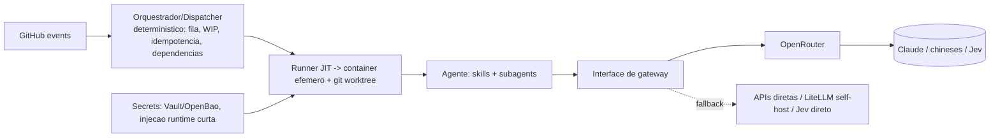

# Síntese da Pesquisa — Continuous Development

> Fase: **PESQUISA**. Este documento **sintetiza e amarra** as 14 trilhas (0, A–M) sem substituí-las —
> o detalhe completo, as fontes e as perguntas em aberto permanecem em cada `research/<trilha>.md`.
> Estado: rascunho forte pós **3 rodadas de auditoria independente** (PRs #14 / #16 / #18).
>
> 🧱 **Vistas estruturais em padrão C4** (Context/Container/Component + esboços de implementação):
> [`ARCHITECTURE-C4.md`](ARCHITECTURE-C4.md). Os diagramas abaixo são de **processo/estado** (fluxo,
> máquina de estados, escada) — **complementares** ao C4, não substitutos.

---

## 1. Visão em uma frase

Um **fleet de agentes** que cobre o ciclo de vida de desenvolvimento de software usando o **GitHub**
como substrato (issue = fonte da verdade, PR/CI = feedback loop), com **economia de token** e
**determinismo** como objetivos de primeira classe.

## 2. Princípios-guia

| Princípio | Em uma linha | Trilha |
|-----------|--------------|--------|
| **Determinismo primeiro** (mãe) | preferir código/processo à decisão de LLM onde der | todas |
| **Ferramentificação** | operação repetida → artefato durável (script/MCP/skill) | F |
| **Right-sizing de modelo** | escada check → Jev → frontier; não usar Opus p/ tudo | I |
| **Não copiar o organograma humano** | papel vira agente só se não for resolvido por processo | 0 |
| **Spec-driven / quem gera não valida** | spec versionada governa; revisor ≠ autor | A, D, H |
| **Economia de token** | objetivo mensurável, não slogan | F, C, L |
| **Disciplina de fontes** | primária/acadêmica vs. vendor/blog (indicativo, a verificar) | todas |

## 3. O fleet (Trilha 0)

9 agentes dedicados + a camada de orquestração. Papéis que viram **processo determinístico** (sem agente):
DBA/schema, deploy/release mechanics, gate de QA, grande parte de DevOps (IaC/pipeline).

| Agente | Gatilho | Tier de modelo típico |
|--------|---------|------------------------|
| Refinamento | reativo / sob demanda | barato + gate humano (priorização) |
| Arquitetura/Design | reativo (épico grande) / sob demanda | frontier (alto) + gate humano |
| Planejamento | reativo | médio |
| Implementação | reativo (plano aprovado) | geração barata (chineses) → frontier no difícil |
| Testes | reativo | barato (gera testes; CI roda) |
| Review de PR | reativo (PR aberto) | multi-agente + Jev; frontier no sensível |
| Segurança | **ambiente** (feed/schedule) | barato + CI determinístico |
| SRE/Incidente | ambiente/alerta | frontier no diagnóstico |
| Documentação | reativo + ambiente (drift) | barato |
| **Orquestrador/Dispatcher** | reativo | **processo determinístico** (fila, WIP, idempotência) |

## 4. Fluxo end-to-end

## 5. Máquina de estados da issue (Trilha A)

- **DoR** (gate de prontidão): issue *self-contained*; **tipagem de task** (definição vs
  desenvolvimento — não desenvolver o que é de definição); validador em camadas
  (checklist determinístico → Jev → frontier); **fail-closed no pickup**.
- **DoD**: quase tudo determinístico — CI verde, cobertura, **review por agente ≠ autor**, docs, sem regressão de segurança.
- **Gates humanos** (Trilha H): priorização, merge, conflito, decisão arquitetural, mudança de credencial —
  seletivos por design (risk-tiering + amostragem + lote), senão recriam o gargalo humano.

## 6. Gatilhos → agentes (Trilha B)

| Evento GitHub | Tipo | Agente |
|---------------|------|--------|
| `issues` opened/edited | reativo | Refinamento + gate de prontidão |
| `issues` labeled `ready` | reativo | Planejamento |
| `issue_comment` (`@claude`/aprovação) | reativo/sob demanda | loop de definição / responde |
| `pull_request` opened / synchronize | reativo | Review / re-review (loop fix→review) |
| `workflow_run` falho | reativo | Implementação (corrige CI) |
| `schedule` + feed | **ambiente** | Segurança, drift de docs, deps |

Confiabilidade (determinística): idempotency key por arquitetura (Actions = `head_sha`+evento+nº),
enfileirar tarefas longas, retry+backoff+DLQ, concurrency groups. Anti-loop: filtro-por-actor **com
exceções** (preserva o loop desejado) + loop breaker bounded.

## 7. Escada de validação / roteamento (Trilha I)

- **Substrato: OpenRouter** (decidido) — API pay-per-token, billing único, acesso a provedores
  **chineses** (DeepSeek, Qwen-Coder, GLM, Kimi) baratos p/ geração; Claude frontier no topo; Jev como guardrail.
- **Contingência**: falar com uma **interface de gateway** (OpenRouter = uma implementação) + fallback
  (APIs diretas / LiteLLM self-host); Jev também via API direta — não virar ponto único.
- **Mapa modelo→tarefa por benchmark** (SWE-bench Verified/Pro, LiveCodeBench, CodeJudgeBench,
  ClarifyCodeBench…): candidatos **indicativos**, **validados no golden set** (não pinar por leaderboard; mapa vivo).

## 8. Runtime & orquestração (Trilhas B + K)

- Container **não-root, efêmero, 1 por task + git worktree** (paralelismo sem colisão); egress
  deny-all/allowlist; `--read-only` + `--cap-drop=ALL`; **gVisor/Firecracker para código não-confiável**
  (PR externo em repo público **exige** isolamento forte — não é opcional-MVP).
- Secrets por **injeção runtime de credencial curta** (Vault/OpenBao); SOPS/Ansible Vault só p/ config estática.

## 9. Memória & continuidade (Trilha G)

**Separar STORAGE de SEARCH**: storage = `.md` + git (fonte da verdade, auditável, com rollback);
search = índice derivado **rebuildável** (SQLite FTS5/BM25, recall sem LLM). Frameworks externos
(Mem0/Zep/Letta) só como **exceção** justificada. Esboço de formato de memória `.md` proposto na trilha.

## 10. Transversais: qualidade, escala e custo (H · J · L)

- **Evals (H)**: golden set de **falhas reais** (50–200, versionado), LLM-judge calibrado 85–90%,
  **regressão bloqueia merge**; checks determinísticos cobrem 60–70%. Princípio unificador:
  **output do modelo = proposta; política determinística decide** (`jev-guard` deny/ask/allow).
- **Escala (J)**: merge queue (batch N→1 CI), test impact analysis (-50–70%), quarentena de flaky,
  WIP/backpressure, **grafo de dependências** (`blocked` não executa; conflito = gate humano).
- **Custo (L)**: teto = **R$550/mês de gasto de API** (câmbio explícito); **baseline numérico a medir**
  no golden set; review (D) **não batcheia** → entra no orçamento; **latência também orçada**.

## 11. Decisões tomadas

| Data | Decisão |
|------|---------|
| 2026-10-18 | Fase controlada: só muda com aprovação explícita do dono |
| 2026-10-18 | Repo do projeto = `CenturyBoys/roboto`; backlog dogfood (épico #13 + issues) |
| 2026-10-18 | **Fleet completo** (9 agentes), ordem via grafo de dependência |
| 2026-10-18 | Cobrança = **API pay-per-token via OpenRouter**; Max (~R$550/mês) = teto-alvo em $ |
| 2026-10-18 | **Jev** (via OpenRouter, autorizado pelo CTO) como judge/guardrail, isolado atrás de interface |
| 2026-10-18 | Provedores **chineses** p/ geração; política de sensibilidade de dado vale já |
| 2026-10-18 | Review: multi-agente por dimensão + verificação adversarial; reviewer ≠ autor |

## 12. Perguntas em aberto (consolidado)

- Mix fino de provedores por etapa + política de fallback (I) → resolver medindo.
- Rateio do teto mensal por tipo de agente + budget por issue; plataforma de observabilidade (L/H).
- Stack inicial do `roboto` (linguagem/framework) → fixa comandos/linter (E), ferramenta de impacto (J).
- Catálogo de ações que **exigem** gate humano (H); MVP de skills e onde vivem (C).
- gVisor/Firecracker desde o MVP para o caminho de PR externo (K).
- Parciais de auditoria: citações arXiv `26xx` em A; hosting de skills em C.

## 13. Índice de trilhas

| # | Trilha | Arquivo |
|---|--------|---------|
| 0 | Mapa de papéis → agentes | `00-mapa-de-papeis.md` |
| A | Contratos de trabalho (épico/issue/DoR/DoD) | `A-contratos-de-trabalho.md` |
| B | Orquestração e gatilhos | `B-orquestracao-e-gatilhos.md` |
| C | Design de skills | `C-design-de-skills.md` |
| D | Review de PR | `D-review-de-pr.md` |
| E | AGENTS.md e padrões de código | `E-agents-md-e-padroes.md` |
| F | Token, ferramentas e ferramentificação | `F-token-e-ferramentas.md` |
| G | Memória / second brain | `G-memoria-e-second-brain.md` |
| H | Qualidade, segurança, evals, gates, recuperação | `H-qualidade-seguranca-recuperacao.md` |
| I | Roteamento de modelos | `I-roteamento-de-modelos.md` |
| J | Escala: build/CI, testes e revisores | `J-escala-ci-build-review.md` |
| K | Runtime containerizado | `K-runtime-containerizado.md` |
| L | Modelo de custo do fleet | `L-modelo-de-custo.md` |
| M | Observabilidade operacional, Telegram e checkpoints | `M-observabilidade-telegram-checkpoints.md` |

Auditorias: `research/audits/` (via PRs #14 e #16). Prompt do auditor: `prompts/revisor-pesquisa.md`.
